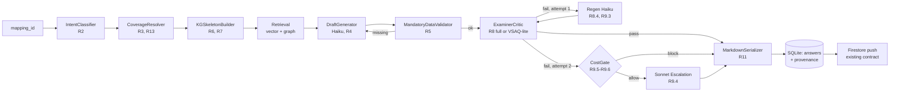

# Design Document — Medical-Grade Answer Pipeline

> **Pass 1** (above the Error Handling section) defines architecture, module layout, Pydantic schema,
> DB delta, API contracts, and control flow. **Pass 2** (Error Handling matrix onward) appends verbatim
> system prompts, validator regex, mnemonic dictionary contents, the markdown serializer worked example,
> the exhaustive failure-mode matrix, and the property-based test catalog.

## Overview

The pipeline replaces `backend/answers/generator.py` with a section-aware, KG-grounded, critic-verified answer
generator that emits structured JSON conforming to the LAQ_Skeleton (R1) plus a markdown rendering for the
existing Firestore push contract (R11). Five moving parts carry the design: an **IntentClassifier** (R2)
labels the question and extracts `focus_topic`; a **CoverageResolver** (R3, R13) maps `(question_type, intent)`
to which sections get populated and how deeply; a **KGSkeletonBuilder** (R6, R7) reuses
`backend/knowledge/graph_builder.py` to inject must-know concepts and `Concept --[relation]--> Concept` lines
into the prompt; a **DraftGenerator** + **MandatoryDataValidator** + **ExaminerCritic** loop (R4, R5, R8)
enforces depth calibration, drug/dose/range completeness, and a critic-driven retry; a **CostGate** (R9)
caps per-batch and per-day Sonnet escalation against `settings.batch_cost_ceiling_usd` and
`settings.daily_cost_ceiling_usd`. A **MarkdownSerializer** (R11) renders the structured object back into the
markdown shape `qb/firestore_pusher.py` already pushes, so the Android app and dashboard need no changes.

## Architecture



## Components and Interfaces

### Module layout

All files live under `backend/answers/`. The legacy `generator.py` is deleted; `pipeline.py` exports
`generate_answers` so `server.py`'s import path is unchanged.

```
backend/answers/
├── __init__.py          # re-exports generate_answers, regenerate_answer, purge_answers
├── pipeline.py          # orchestrator — replaces generator.py entry point
├── schema.py            # Pydantic v2 AnswerSections + leaf bullet models (R1)
├── intent.py            # IntentClassifier (R2)
├── coverage.py          # resolve_coverage_mode pure function (R3, R13)
├── kg_skeleton.py       # KGSkeletonBuilder using graph_builder.py (R6, R7)
├── retrieval.py         # vector + graph retrieval (adapted from existing _retrieve_* helpers)
├── prompts.py           # prompt templates — bodies land in pass 2
├── draft.py             # DraftGenerator: wraps the Claude call + JSON parse (R4)
├── validators.py        # MandatoryDataValidator pure-Python checks (R5)
├── critic.py            # ExaminerCritic — full and VSAQ-lite (R8)
├── cost_gate.py         # cost ceiling enforcement (R9)
├── markdown.py          # serialize_to_markdown (R11)
├── mnemonics.py         # hard-coded mnemonic dictionary (~20 entries, R14)
└── errors.py            # typed exceptions (SchemaViolation, MandatoryDataMissing, CostBlocked, ...)
```

### Requirement → Module mapping

| Req | Description | Primary module | Helpers |
|-----|-------------|----------------|---------|
| R1  | Section-aware schema, empty-section collapse | `schema.py` | `pipeline.py` |
| R2  | Question intent + focus_topic + low-confidence flag | `intent.py` | `prompts.py` |
| R3  | Coverage mode decision (VSAQ/SAQ/LAQ) | `coverage.py` | `pipeline.py` |
| R4  | Depth calibration in system prompt + critic depth_score | `prompts.py`, `critic.py` | `draft.py` |
| R5  | Mandatory drug-class/dose/range/year structural validator + 1× re-prompt | `validators.py` | `pipeline.py`, `draft.py` |
| R6  | KG_Skeleton_Block construction from `graph_builder.py` | `kg_skeleton.py` | `retrieval.py` |
| R7  | Must-know gating in prompt + critic verification | `kg_skeleton.py`, `critic.py` | — |
| R8  | Examiner critic loop, full + VSAQ-lite | `critic.py` | `pipeline.py` |
| R9  | Tiered model strategy + cost ceiling enforcement | `cost_gate.py`, `pipeline.py` | `config.py` |
| R10 | Purge old answers admin action | `pipeline.py` (`purge_answers`) | `state/db.py`, `qb/firestore_pusher.py` |
| R11 | Markdown serialization preserving Firestore contract | `markdown.py` | `qb/firestore_pusher.py` |
| R12 | Provenance metadata + UI badges | `pipeline.py`, `schema.py` (`Provenance`) | `frontend/app/answers/page.js` |
| R13 | VSAQ section-specific output + disambiguation fallback | `coverage.py` | `intent.py` |
| R14 | Mnemonics as organizational anchors | `mnemonics.py`, `prompts.py` | `markdown.py` |
| R15 | Traceability of bullets to chunks/concepts | `critic.py`, `schema.py` | `retrieval.py` |

### Pipeline orchestrator — public + internal signatures

```python
# backend/answers/pipeline.py
from .schema import AnswerSections
# Auxiliary types defined below in `## Data Models`.

async def generate_answers(
    mapping_ids: list[str],
    force_regenerate: bool = False,
    progress_callback=None,
) -> "GenerateBatchResult":
    """Public entry point. Preserves the import path `from answers.generator import
    generate_answers` used by `server.py` via the `__init__.py` re-export.
    Iterates mapping_ids, calls _process_one for each, accumulates per-batch spend,
    streams SSE progress (see SSE Event Extensions), returns a GenerateBatchResult."""

async def regenerate_answer(answer_id: str) -> "GenerateBatchResult":
    """Re-runs the pipeline for a single existing answer. Looks up the mapping_id
    from the answer record and delegates to generate_answers([mapping_id], force=True)."""

async def purge_answers(subject: str | None, confirm: bool) -> "PurgeReport":
    """Admin action (R10). Refuses if confirm is false. Deletes rows in `answers`,
    resets `mappings.is_answered = 0` for the scope, and removes matching Firestore
    documents by mappingId when a service account is configured."""

# ── internal helpers (signatures only) ──

async def _process_one(mapping_id: str, ctx: dict) -> "AnswerRecord": ...

async def _classify_intent(question_text: str, question_type: str) -> "QuestionIntent": ...

async def _build_kg_skeleton(question_text: str, subject: str) -> "KGSkeleton": ...

async def _retrieve(
    question_text: str,
    chapter_id: str,
    subject: str,
    mode: "CoverageMode",
) -> "RetrievedContext": ...

async def _generate_draft(ctx: "DraftContext", model: str) -> AnswerSections: ...

async def _critique(ctx: "DraftContext", draft: AnswerSections, lite: bool) -> "CriticVerdict": ...

def _persist(answer_record: "AnswerRecord") -> None: ...
```

### Coverage mode decision table (R3, R13)

`per_section_caps` is the **max bullets per leaf list** (e.g. `clinical_features.symptoms`). `n` denotes
`requested_item_count` when present (R3.2). Resolution lives in
`coverage.py::resolve_coverage_mode(question_type, intent, focus_topic, requested_item_count)` as a pure
function returning a `CoverageMode`.

| question_type | intent              | sections_to_populate                                                                                  | per_section_caps      | depth_target |
|---------------|---------------------|-------------------------------------------------------------------------------------------------------|-----------------------|--------------|
| VSAQ          | define              | `definition`                                                                                          | n/a                   | vsaq         |
| VSAQ          | features_of         | `clinical_features`                                                                                   | `n or 5`              | vsaq         |
| VSAQ          | management_of       | `management`                                                                                          | `n or 5`              | vsaq         |
| VSAQ          | investigations_of   | `investigations`                                                                                      | `n or 5`              | vsaq         |
| VSAQ          | complications_of    | `complications`                                                                                       | `n or 5`              | vsaq         |
| VSAQ          | etiology_of         | `etiology`                                                                                            | `n or 5`              | vsaq         |
| VSAQ          | enumerate           | one section inferred from focus_topic (R13.6)                                                         | `n` (required)        | vsaq         |
| VSAQ          | classify            | `classification`                                                                                      | `n or 4`              | vsaq         |
| VSAQ          | (unresolvable)      | `definition` + best-guess section, `vsaq_disambiguation_fallback=true` (R13.7)                        | `n or 4`              | vsaq         |
| SAQ           | discuss / —         | full LAQ_Skeleton                                                                                     | 2 per leaf list (R3.3)| saq          |
| SAQ           | mechanism_of        | `pathophysiology` only                                                                                | 6                     | laq          |
| SAQ           | management_of       | `management` only                                                                                     | 6                     | laq          |
| SAQ           | features_of         | `clinical_features` only                                                                              | 6 per sub-key         | laq          |
| SAQ           | investigations_of   | `investigations` only                                                                                 | 4 per sub-key         | laq          |
| SAQ           | complications_of    | `complications` only                                                                                  | 4 per sub-key         | laq          |
| LAQ           | discuss / —         | full LAQ_Skeleton incl. `definition` always populated (R3.6)                                          | 4–6 per leaf list     | laq          |
| LAQ           | mechanism_of        | `definition`, `etiology`, `pathophysiology` (deep), `clinical_features` (compressed)                  | 8 in pathophysiology  | laq          |

## Data Models

### Section_Schema (Pydantic v2)

Pydantic enforces **shape only**. Mark-earning rules (drug-class + dose + frequency, range/cutoff, year on
classification) live in `validators.py` because they are not type errors — they are exam-grading rules that
must produce structured violation reports the model can act on (R5.5).

```python
# backend/answers/schema.py
from __future__ import annotations
from typing import Optional
from pydantic import BaseModel, Field, model_validator


class Bullet(BaseModel):
    text: str
    source_chunk_ids: list[str] = Field(default_factory=list)  # R8 traceability, R15
    kg_concept_ids: list[str] = Field(default_factory=list)


class PharmBullet(Bullet):
    drug_class: str
    drug_name: str
    dose: str
    frequency: str


class InvestigationBullet(Bullet):
    test_name: str
    value_or_range: str  # normal range OR diagnostic cutoff (R5.2)


class ClassificationEntry(Bullet):
    system_name: str       # "WHO", "NYHA", "GOLD", "TNM", "Wells", "Killip", ...
    year: int              # R5.3 — must be present
    categories: list[str]


class PathoStep(Bullet):
    step_index: int        # sequential ordering verified by parent (R4.3)


class ClinicalFeatures(BaseModel):
    symptoms: list[Bullet] = Field(default_factory=list)
    signs: list[Bullet] = Field(default_factory=list)
    hallmarks: list[Bullet] = Field(default_factory=list)


class Investigations(BaseModel):
    bedside: list[InvestigationBullet] = Field(default_factory=list)
    lab: list[InvestigationBullet] = Field(default_factory=list)
    imaging: list[InvestigationBullet] = Field(default_factory=list)


class Management(BaseModel):
    non_pharm: list[Bullet] = Field(default_factory=list)
    pharm: list[PharmBullet] = Field(default_factory=list)
    surgical: list[Bullet] = Field(default_factory=list)
    targets: list[Bullet] = Field(default_factory=list)


class Complications(BaseModel):
    acute: list[Bullet] = Field(default_factory=list)
    chronic: list[Bullet] = Field(default_factory=list)


class AnswerSections(BaseModel):
    """Top-level structured answer. Every section is optional (R1.6). Field order is
    preserved on serialization so the LAQ_Skeleton ordering survives JSON round-trip (R1.7)."""

    definition: Optional[str] = None
    classification: Optional[list[ClassificationEntry]] = None
    etiology: Optional[list[Bullet]] = None
    pathophysiology: Optional[list[PathoStep]] = None
    clinical_features: Optional[ClinicalFeatures] = None
    investigations: Optional[Investigations] = None
    management: Optional[Management] = None
    complications: Optional[Complications] = None
    prognosis: Optional[list[Bullet]] = None

    # Optional per-section mnemonic anchor (R14)
    mnemonics: dict[str, str] = Field(default_factory=dict)

    @model_validator(mode="after")
    def _collapse_empty(self) -> "AnswerSections":
        """Per R1.6: any structurally-empty container collapses to None so the
        serialized JSON contains only sections the active Coverage_Mode gated in."""

        def _empty_seq(v) -> bool:
            return v is None or (isinstance(v, list) and len(v) == 0)

        # Composite sections: empty iff every leaf list is empty.
        if self.clinical_features is not None:
            cf = self.clinical_features
            if _empty_seq(cf.symptoms) and _empty_seq(cf.signs) and _empty_seq(cf.hallmarks):
                self.clinical_features = None

        if self.investigations is not None:
            inv = self.investigations
            if _empty_seq(inv.bedside) and _empty_seq(inv.lab) and _empty_seq(inv.imaging):
                self.investigations = None

        if self.management is not None:
            mg = self.management
            if (_empty_seq(mg.non_pharm) and _empty_seq(mg.pharm)
                    and _empty_seq(mg.surgical) and _empty_seq(mg.targets)):
                self.management = None

        if self.complications is not None:
            cp = self.complications
            if _empty_seq(cp.acute) and _empty_seq(cp.chronic):
                self.complications = None

        # Leaf-list sections: empty list collapses to None.
        for fld in ("classification", "etiology", "pathophysiology", "prognosis"):
            v = getattr(self, fld)
            if isinstance(v, list) and len(v) == 0:
                setattr(self, fld, None)

        # `definition` is a plain string — empty string collapses to None.
        if isinstance(self.definition, str) and not self.definition.strip():
            self.definition = None

        return self
```

### Auxiliary types

```python
# Embedded in pipeline.py / schema.py — only field names + types here, no behaviour.

class QuestionIntent(BaseModel):
    intent: str                         # one of the R2.1 label set
    focus_topic: str
    requested_item_count: Optional[int] = None
    intent_confidence_low: bool = False

class CoverageMode(BaseModel):
    mode: str                           # vsaq_focused | saq_compressed | saq_narrow_deep | laq_full
    sections_to_populate: list[str]
    per_section_caps: dict[str, int]
    depth_target: str                   # "vsaq" | "saq" | "laq"
    vsaq_disambiguation_fallback: bool = False

class KGSkeleton(BaseModel):
    concept_ids: list[str]
    relation_ids: list[str]
    must_know_concept_ids: list[str]
    skeleton_block_text: str            # the formatted "Concepts: ... Relations: ..." prompt segment
    used: bool                          # false when no concepts matched (R6.5)

class RetrievedContext(BaseModel):
    chunk_ids: list[str]
    chunk_texts: list[str]
    cited_textbook_pages: list[int]
    retrieval_mode: str                 # "vector_only" | "graph_only" | "hybrid"

class Violation(BaseModel):
    section_path: str                   # e.g. "management.pharm[2]"
    code: str                           # MISSING_FREQUENCY | MISSING_CUTOFF | MISSING_YEAR | ...
    detail: str

class MandatoryDataReport(BaseModel):
    ok: bool
    violations: list[Violation]

class CriticVerdict(BaseModel):
    verdict: str                        # "pass" | "fail"
    score: int                          # 0–100
    structure_score: int
    depth_score: int
    traceability_score: int
    mandatory_data_score: int
    too_shallow_bullets: list[str] = []
    too_deep_bullets: list[str] = []
    missing_must_know: list[str] = []
    feedback: list[str] = []

class Provenance(BaseModel):
    draft_model: str
    critic_model: str
    regen_model: Optional[str] = None
    escalation_model: Optional[str] = None
    critic_verdict: str
    critic_score: int
    must_know_presented: list[str]
    must_know_covered: list[str]
    sections_populated: list[str]
    retrieval_mode: str
    kg_concept_ids_used: list[str]
    kg_relation_ids_used: list[str]
    cited_textbook_pages: list[int]
    cost_ceiling_blocked: bool = False

class AnswerRecord(BaseModel):
    id: str
    mapping_id: str
    sections: AnswerSections
    markdown: str
    coverage_mode: str
    question_intent: str
    focus_topic: str
    requested_item_count: Optional[int] = None
    intent_confidence_low: bool = False
    mandatory_data_complete: bool = True
    vsaq_disambiguation_fallback: bool = False
    kg_skeleton_used: bool
    provenance: Provenance

class GenerateBatchResult(BaseModel):
    generated: int
    failed: int
    cost_blocked: int
    batch_spend_usd: float
    daily_spend_usd: float
    answer_ids: list[str]
    errors: list[str] = []

class PurgeReport(BaseModel):
    answers_deleted: int
    mappings_reset: int
    firestore_documents_deleted: int
```

### Database schema delta

SQLite has no `ALTER TABLE ... ADD COLUMN IF NOT EXISTS`, so each `ALTER` runs inside its own
`try/except aiosqlite.OperationalError` block in `init_db()` — matching the migration pattern already
established in `state/db.py`.

```sql
-- answers table additions
ALTER TABLE answers ADD COLUMN sections TEXT;                              -- JSON (R1)
ALTER TABLE answers ADD COLUMN markdown TEXT;                              -- rendered markdown (R11)
ALTER TABLE answers ADD COLUMN coverage_mode TEXT;                         -- R3.7
ALTER TABLE answers ADD COLUMN question_intent TEXT;                       -- R2.3
ALTER TABLE answers ADD COLUMN focus_topic TEXT;                           -- R2.3
ALTER TABLE answers ADD COLUMN requested_item_count INTEGER;               -- R2.5
ALTER TABLE answers ADD COLUMN intent_confidence_low INTEGER DEFAULT 0;    -- R2.4
ALTER TABLE answers ADD COLUMN provenance TEXT;                            -- JSON (R12)
ALTER TABLE answers ADD COLUMN mandatory_data_complete INTEGER DEFAULT 1;  -- R5.7
ALTER TABLE answers ADD COLUMN vsaq_disambiguation_fallback INTEGER DEFAULT 0; -- R13.7
ALTER TABLE answers ADD COLUMN kg_skeleton_used INTEGER DEFAULT 0;         -- R6.5

-- new table for daily cost ceiling (R9)
CREATE TABLE IF NOT EXISTS daily_cost_log (
    date TEXT PRIMARY KEY,             -- UTC YYYY-MM-DD
    total_usd REAL DEFAULT 0,
    calls_count INTEGER DEFAULT 0
);
```

Idempotent migration sketch inside `state/db.py::init_db()`:

```python
NEW_ANSWER_COLS = [
    ("sections", "TEXT"),
    ("markdown", "TEXT"),
    ("coverage_mode", "TEXT"),
    ("question_intent", "TEXT"),
    ("focus_topic", "TEXT"),
    ("requested_item_count", "INTEGER"),
    ("intent_confidence_low", "INTEGER DEFAULT 0"),
    ("provenance", "TEXT"),
    ("mandatory_data_complete", "INTEGER DEFAULT 1"),
    ("vsaq_disambiguation_fallback", "INTEGER DEFAULT 0"),
    ("kg_skeleton_used", "INTEGER DEFAULT 0"),
]
for col, decl in NEW_ANSWER_COLS:
    try:
        await db.execute(f"ALTER TABLE answers ADD COLUMN {col} {decl}")
        await db.commit()
    except aiosqlite.OperationalError:
        pass  # column already exists — idempotent
```

Two new `settings` fields are added to `backend/config.py` for R9:
`batch_cost_ceiling_usd: float = 0.50` and `daily_cost_ceiling_usd: float = 5.00`.

## API Contracts

Three endpoints live in `server.py`. Only schemas are listed — handler bodies are out of scope for the
design (they are straightforward FastAPI routes that call the pipeline functions defined above).

```python
# POST /api/answers/generate
class GenerateRequest(BaseModel):
    mapping_ids: list[str]
    force_regenerate: bool = False

class GenerateResponse(BaseModel):
    task_id: str
    message: str
# SSE events stream over the existing /api/progress/{task_id} channel.


# POST /api/answers/purge   (R10)
class PurgeRequest(BaseModel):
    subject: str | None = None
    confirm: bool = False    # 400 returned if confirm is False AND subject is None

class PurgeReport(BaseModel):
    answers_deleted: int
    mappings_reset: int
    firestore_documents_deleted: int


# GET /api/answers/{id}  — additions ON TOP OF the existing response shape
#   sections: dict          # AnswerSections JSON (R1)
#   provenance: dict        # Provenance JSON (R12)
#   markdown: str           # rendered markdown (R11)
#   coverage_mode: str
#   question_intent: str
#   focus_topic: str
#   requested_item_count: int | None
#   intent_confidence_low: bool
#   mandatory_data_complete: bool
#   kg_skeleton_used: bool
```

**Breaking change.** The legacy `preset` / `style` / `mode` form fields on
`POST /api/answers/generate` are removed. Coverage and depth are now derived from question type +
intent — there is no user-facing toggle. `frontend/app/answers/page.js` and `frontend/lib/api.js` change
accordingly (see `## Frontend Changes`).

## Cost Ceiling State Machine (R9)

1. Read `settings.batch_cost_ceiling_usd` and `settings.daily_cost_ceiling_usd` once at orchestrator entry.
2. Per-batch spend is tracked in-memory on the orchestrator instance and exposed via SSE `cost_blocked` events.
3. Per-day spend is read from / written to the `daily_cost_log` table keyed by UTC date — survives restarts.
4. Before every Claude call, `cost_gate.check(stage, projected_cost)` returns `allow` or `block`. Stages:
   `draft` (always allowed), `critic` (always allowed), `regen_haiku` (always allowed),
   `escalation_sonnet` (subject to ceiling).
5. On `block` the pipeline skips Sonnet escalation, persists the latest Haiku draft, sets
   `provenance.cost_ceiling_blocked = true` (R9.6), and emits a `cost_blocked` SSE event.

## SSE Event Extensions

Reuses the existing `progress_queues` mechanism in `server.py`. New event payloads:

- `intent_classified` — `{ intent, focus_topic, confidence_low }`
- `kg_skeleton_built` — `{ concept_count, relation_count, must_know_count }`
- `draft_done` — `{ sections_populated, model }`
- `validator_done` — `{ violations_count }`
- `critic_done` — `{ verdict, score }`
- `regen_done` — `{ model, attempt }`
- `escalated` — `{ from_model, to_model, reason }`
- `persisted` — `{ answer_id }`
- `cost_blocked` — `{ stage, projected_usd, ceiling_usd }`

## Frontend Changes (R12)

`frontend/app/answers/page.js`:
- Drop the preset selector (LAQ/SAQ/VSAQ), the bullet style toggle, and the retrieval mode dropdown.
- Add critic-verdict pill (green pass / red fail) bound to `provenance.critic_verdict`.
- Add numeric score badge bound to `provenance.critic_score` (always rendered alongside the pill — R12.6).
- Add must-know coverage indicator showing `must_know_covered / must_know_presented` (R12.7).
- Add a `cost_ceiling_blocked` warning chip when the provenance flag is set.
- Add a "Purge old answers" admin button in the page header — calls `purgeAnswers` with a confirm dialog.

`frontend/lib/api.js`:
- Change `generateAnswers` signature to `(mappingIds: string[], forceRegenerate?: boolean)`. Drop preset,
  style, mode arguments.
- Add `purgeAnswers(subject?: string, confirm: boolean)` calling `POST /api/answers/purge`.

## Error Handling

The typed-exception hierarchy below is the routing layer; the per-failure matrix that follows is the
recovery contract.

`backend/answers/errors.py` defines the typed exception hierarchy:

- `AnswerPipelineError` (base)
  - `SchemaViolation` — model returned a key outside the R1 set (logged + dropped per R1.9).
  - `MandatoryDataMissing` — raised by the validator when re-prompt fails (R5.7 fallback path).
  - `CriticFailure` — critic returned `fail` after all retries (R8.5).
  - `CostBlocked` — cost gate blocked Sonnet escalation (R9.6 — non-fatal, signals graceful fallback).
  - `KGUnavailable` — graph_builder lookup failed (fall back to vector-only, set `kg_skeleton_used=false`, R6.5).

Exceptions raised inside `_process_one` are caught at the `generate_answers` boundary and recorded in
`GenerateBatchResult.errors` so a single failing mapping never aborts the batch.

### Exhaustive Failure-Mode Matrix

Each row is a contract: trigger → detection → recovery → user-visible result → effect on the
`Provenance` block. "Trace" denotes a structured log line emitted via `logger.warning` / `logger.error`
with the `mapping_id` in the `extra` dict.

| Failure | Trigger | Detection | Recovery | User-visible result | Provenance impact |
|---|---|---|---|---|---|
| Malformed JSON from draft Claude call | Model returns non-JSON or JSON that violates `AnswerSections` | `pydantic.ValidationError` raised by `AnswerSections.model_validate` inside `draft.generate` | One retry with addendum *"OUTPUT ONLY JSON, NO PROSE"* reusing `claude/client.py::_repair_truncated_json` for truncation cases; if still failing, raise `SchemaViolation` and persist a `failed` answer with empty `sections` | SSE `error` event then per-mapping entry in `GenerateBatchResult.errors`; UI shows red "schema violation" pill | `provenance.critic_verdict = "fail"`, `provenance.draft_model = haiku`, `sections_populated = []` |
| Mandatory-data validator fails twice on same section | Validator returns non-empty `violations` after the one re-prompt allowed by R5.6 | `validators.check_*` returns `ok=false` post-reprompt | Persist draft with `mandatory_data_complete=false` (R5.7); attach the violation list to `provenance.mandatory_data_violations`; critic still runs on the imperfect draft | Yellow pill "mandatory data incomplete"; full draft visible | `mandatory_data_complete=false`; `provenance.mandatory_data_violations = [Violation, …]` |
| Critic fail after Haiku regen | `CriticVerdict.verdict == "fail"` after the one allowed Haiku regen (R8.4, R8.5) | `_critique` returns `verdict="fail"` on attempt 2 | Cost gate decides: allow → Sonnet escalation; block → persist Haiku draft | If escalated: pipeline continues; if blocked: red pill plus warning chip | `provenance.regen_model = haiku`; `provenance.escalation_model` set iff escalation runs |
| Critic fail after Sonnet escalation | `verdict == "fail"` even after Sonnet (R8.5 cap) | `_critique` returns `fail` on Sonnet attempt | Persist draft with `provenance.critic_verdict = "fail"`; no further retry | Red pill in `frontend/app/answers/page.js` with the critic feedback array surfaced | `provenance.critic_verdict = "fail"`, `provenance.escalation_model = sonnet`, full critic feedback embedded |
| Cost ceiling hit on batch boundary | Projected Sonnet escalation cost would push `batch_spend_usd` over `settings.batch_cost_ceiling_usd` | `cost_gate.check("escalation_sonnet", projected) == "block"` because batch spend would exceed | Skip Sonnet, persist Haiku draft, set `cost_ceiling_blocked=true` (R9.6), emit `cost_blocked` SSE event | Warning chip "cost ceiling: batch" alongside the red verdict pill | `cost_ceiling_blocked=true`; `escalation_model = null` |
| Cost ceiling hit on per-day boundary | Today's `daily_cost_log.total_usd + projected > settings.daily_cost_ceiling_usd` | Same gate, daily branch | Same as batch-ceiling row, with chip text "cost ceiling: daily" | Warning chip "cost ceiling: daily" | `cost_ceiling_blocked=true`; `escalation_model = null` |
| KG matched zero concepts | `get_extended_concepts_for_question(...)` returns `{"concept_ids": [], …}` | `KGSkeleton.used` will be set false | Fall back to vector-only retrieval; pipeline continues with `kg_skeleton_used=false` (R6.5); KG_Skeleton_Block omitted from prompt | Info chip "KG miss"; answer still produced | `kg_skeleton_used=false`; `provenance.kg_concept_ids_used = []`; `provenance.retrieval_mode = "vector_only"` |
| Vector retrieval also empty | Both KG and vector retrieval return zero chunks (e.g., subject has no ingested chunks) | `RetrievedContext.chunk_ids == []` | Persist a `failed` answer with one definition bullet stating *"Insufficient source material"*; set `traceability_score=0`, `verdict="fail"`; do NOT crash the batch | Red pill plus chip "no sources" | `provenance.cited_textbook_pages = []`, `provenance.kg_concept_ids_used = []`, `traceability_score = 0` |
| Concurrent generate request for same mapping | Second `POST /api/answers/generate` arrives while first is in-flight | In-memory `asyncio.Lock` keyed by `mapping_id` in `pipeline.py` (`_inflight_locks: dict[str, asyncio.Lock]`) | Return `409 Conflict` with body `{"error": "generation_in_progress", "mapping_id": ...}`; do not enqueue twice | Frontend toast "this answer is already generating" | n/a — no DB write occurs |
| Firestore unavailable during purge | Service account file missing OR `firestore.client()` raises | `_get_firestore()` raises `FileNotFoundError` or `firebase_admin` raises `DefaultCredentialsError` | Continue SQLite-side deletion; report `firestore_documents_deleted=0` and `firestore_skipped=true` in `PurgeReport`; do not raise | Admin sees toast "Firestore unavailable, local purge complete"; mapping reset still ran | Not a generation event — no provenance impact |
| Daily ceiling reset boundary | UTC midnight tick mid-batch; the `daily_cost_log` row for the new date does not yet exist | `cost_gate.check` queries `daily_cost_log` keyed by `now_utc().strftime("%Y-%m-%d")` and gets no row | Insert new row with `total_usd=0, calls_count=0`; resume under the fresh quota; treat the boundary mapping as a fresh-quota generation | Pipeline transparently continues; spend counter "ticks over" in the SSE channel | `provenance.cost_ceiling_blocked` evaluated against the new day's row |
| Intent classifier returns invalid label | JSON shape OK but `intent` not in the 13-label set (R2.1) | Pydantic discriminator on `QuestionIntent.intent` rejects the value | Coerce to `discuss`; set `intent_confidence_low=true` (R2.4) | UI shows the orange "low confidence" badge | `question_intent="discuss"`, `intent_confidence_low=true` |
| Intent classifier total failure | Exception bubbles out of the Claude call (rate limit exhausted, network drop, schema violation after retry) | Try/except around `_classify_intent` in `pipeline._process_one` | Default to `intent="discuss"`, `focus_topic = question_text[:60]`, `intent_confidence_low=true`; pipeline proceeds | Same orange badge; answer still produced from defaulted intent | `question_intent="discuss"`, `focus_topic` truncated, `intent_confidence_low=true` |
| AnswerSections returns key outside R1 schema | Model invents a section name (e.g., `"differential_diagnosis"`) | Pydantic strict mode (`model_config = ConfigDict(extra="ignore")`) drops unknown fields silently — the dropped key is logged via a `model_validator(mode="before")` hook that records dropped keys to `_dropped_keys` | Drop the unknown key, log warning (R1.9), continue with the cleaned object | None — silent recovery; warning visible in server logs only | n/a (no provenance flag — the dropped keys are listed in the trace log only) |
| Empty AnswerSections after Pydantic collapse | Every section collapsed to None by `_collapse_empty` (model returned only empty containers) | `AnswerSections.model_dump(exclude_none=True)` returns `{}` (or only `mnemonics`) | Critic gives `structure_score=0`, triggers retry per R8.4; if still empty after retry, persist `failed` with empty sections | Red verdict pill, structure score 0 visible | `sections_populated=[]`, `provenance.critic_verdict="fail"`, `structure_score=0` |
| Sonnet model unavailable / rate-limited | Anthropic returns 429 or 503 on escalation call | `anthropic.RateLimitError` / `APIStatusError` propagated by `claude/client.py` | Honour `Retry-After` if present (one wait via the existing `client.request` retry loop); on second failure, persist Haiku draft and set `provenance.escalation_failed=true` | Red pill, warning chip "Sonnet unavailable" | `escalation_failed=true`, `escalation_model=null`, last successful draft preserved |

## Correctness Properties

*A property is a characteristic or behavior that should hold true across all valid executions of a system —
essentially, a formal statement about what the system should do. Properties serve as the bridge between
human-readable specifications and machine-verifiable correctness guarantees.*

### Prework Analysis

The acceptance-criteria → test-classification pre-work is captured by the `prework` tool for this feature.
The high-level scaffolding distilled from that pre-work is:

**Domain types of interest.** `AnswerSections` (R1 root), `Bullet` family (`Bullet`, `PharmBullet`,
`InvestigationBullet`, `ClassificationEntry`, `PathoStep`), `CoverageMode` (R3, R13), `QuestionIntent`
(R2), `MandatoryDataReport` + `Violation` (R5), `CriticVerdict` (R8), `Provenance` + `AnswerRecord` (R12).

**Pure transformations** (directly property-tested):

- `coverage.resolve_coverage_mode(question_type, intent, focus_topic, requested_item_count) → CoverageMode`
- `schema.AnswerSections._collapse_empty` (Pydantic `model_validator(mode="after")`)
- `markdown.serialize_to_markdown(sections: AnswerSections) → str`
- `validators.check_pharm | check_investigations | check_classification | check_bullet_text → MandatoryDataReport`
- `cost_gate.check(stage, projected_cost, batch_spend, daily_spend, ceilings) → "allow" | "block"`

**Stateful transformations** (NOT property-tested directly — mocked at the seam):

- `intent.classify_question` (Claude call)
- `kg_skeleton.build` (graph_builder + DB)
- `draft.generate` (Claude call)
- `critic.evaluate` (Claude call)
- `pipeline._process_one` (orchestrator)

**Test seam.** A `FakeClaudeClient` returns canned JSON keyed by a prompt fingerprint, swapped in via
dependency injection at the `pipeline.py` boundary (`claude_client_factory` parameter, defaulting to
`get_claude_client`). Only P10 and integration tests need the seam; P1–P9 operate over pure functions.

**Property reflection summary.** The raw property pool from the prework had 23 candidates; after
consolidation 10 remain. Subsumed: section-key closure (R1.1) + unknown-key drop (R1.9) ⊂ JSON
round-trip (P7); SAQ-narrow branch ⊂ coverage-resolver totality (P2); markdown level-3/level-4/empty-drop
rules ⊂ markdown round-trip stability (P3); per-validator regex coverage ⊂ validator determinism (P4)
plus example-based coverage already specified in the validator regex appendix (section B). Verdict-logic
properties (R4.7, R8.3, R8.7) are kept as example-based unit tests because the input space is a
4-dimensional grid of `[0, 100]` integers — exhaustive boundary cases beat random sampling.

### Catalog

### Property 1: Schema empty-collapse idempotence

*For any* `AnswerSections` instance `s`, applying the empty-section collapse twice yields the same
result as applying it once.

Formal: `forall s: AnswerSections, validate(validate(s)) == validate(s)`.

Hypothesis strategy: `@given(answer_sections_st())` where `answer_sections_st` is a recursive strategy
producing instances with all combinations of None / empty list / populated leaves.

Why it matters: the validator runs on every `model_validate` and on every JSON round-trip; non-idempotent
collapse would mean repeated I/O could change the persisted shape.

**Validates: Requirements 1.6**

### Property 2: Coverage resolver totality

*For any* `(question_type, intent, focus_topic, requested_item_count)` quadruple drawn from the supported
domain, `resolve_coverage_mode` returns a `CoverageMode` whose `sections_to_populate` is a non-empty
subset of the canonical 9 sections.

Formal:
`forall (qt, intent, focus, n) ∈ (QType × Intent × str × Optional[int]),
let cm = resolve_coverage_mode(qt, intent, focus, n) in
cm.sections_to_populate is non-empty AND cm.sections_to_populate ⊆ CANONICAL_9_SECTIONS`.

Hypothesis strategy: `@given(question_type_st(), question_intent_st(), focus_topic_st(), st.one_of(st.none(), st.integers(1, 20)))`.

Why it matters: the resolver is a pure function with a finite combinatorial input space; a single missing
branch would produce an empty answer downstream.

**Validates: Requirements 3.1, 3.3, 3.4, 3.5, 13.1, 13.2, 13.3, 13.4, 13.5**

### Property 3: Markdown round-trip stability

*For any* `AnswerSections` instance `s`, `serialize_to_markdown(s)` contains a level-3 heading for every
populated top-level section, a level-4 heading for every populated sub-section, and contains NO heading
for any section/sub-section whose value is `None` or an empty list. Pathophysiology bullets, when
present, are joined by `→` in their rendered line.

Formal:
`forall s: AnswerSections,
   let md = serialize_to_markdown(s) in
     (∀ k ∈ populated_sections(s), f"### {humanise(k)}" ∈ md) AND
     (∀ k ∈ empty_sections(s), f"### {humanise(k)}" ∉ md) AND
     (s.pathophysiology is not None ⇒ "→" appears between every adjacent step pair in the patho line)`.

Hypothesis strategy: `@given(answer_sections_st())`.

Why it matters: the markdown is the contract that the Android app and admin dashboard consume; a stray
heading for an empty section would render as a dangling title.

**Validates: Requirements 11.2, 11.3, 11.4, 11.5, 11.7**

### Property 4: Validator violation determinism

*For any* `AnswerSections` instance `s`, the structural validators are pure and deterministic: repeated
calls with the same input return the same `MandatoryDataReport`. No hidden state, no time-of-day
dependence, no randomness.

Formal:
`forall s,
   check_pharm(s) == check_pharm(s) AND
   check_investigations(s) == check_investigations(s) AND
   check_classification(s) == check_classification(s)`.

Hypothesis strategy: `@given(answer_sections_st())`.

Why it matters: the pipeline builds re-prompt payloads from the violation list (R5.5); a non-deterministic
validator would feed the model contradicting feedback across attempts.

**Validates: Requirements 5.1, 5.2, 5.3**

### Property 5: Cost gate monotonicity

*For any* two spends `spend_a < spend_b ≤ ceiling` against the same projected cost `p` for the
`escalation_sonnet` stage, if the gate blocks at `spend_a` it must also block at `spend_b`. And for any
spend strictly above the ceiling, the gate ALWAYS blocks.

Formal:
`forall (spend_a, spend_b, p, ceiling) with 0 ≤ spend_a < spend_b ≤ ceiling,
   check("escalation_sonnet", spend_a, p, ceiling) == "block" ⇒ check("escalation_sonnet", spend_b, p, ceiling) == "block"`
AND
`forall (spend, p, ceiling) with spend > ceiling, check("escalation_sonnet", spend, p, ceiling) == "block"`.

Hypothesis strategy: `@given(st.floats(0, 5), st.floats(0, 5), st.floats(0, 1), st.floats(0.5, 5))` filtered so `spend_a < spend_b`.

Why it matters: monotonicity is the guarantee that prevents the cost ceiling from oscillating across
sequential mappings in the same batch.

**Validates: Requirements 9.6**

### Property 6: Intent label closure

*For any* output of the intent classifier (after the pipeline's coercion layer), the resulting `intent`
field is a member of the 13-label set defined in R2.1.

Formal: `forall raw_classifier_output, pipeline_coerced(raw).intent ∈ INTENT_LABELS_13`.

Hypothesis strategy: `@given(raw_intent_output_st())` where `raw_intent_output_st` produces both valid
and invalid intent strings, plus completely malformed JSON shapes.

Why it matters: the coverage resolver indexes into a label-keyed table; an unknown label would crash the
pipeline.

**Validates: Requirements 2.1, 2.4**

### Property 7: AnswerSections JSON round-trip

*For any* `AnswerSections` instance `s` (after empty-collapse), JSON serialization followed by
`model_validate` reproduces the original instance.

Formal:
`forall s: AnswerSections (post-collapse),
   AnswerSections.model_validate(s.model_dump()) == s`.

Hypothesis strategy: `@given(answer_sections_st())`.

Why it matters: SQLite stores `sections` as JSON text; round-trip preserves both key order (R1.7) and
bullet shape (R1.8).

**Validates: Requirements 1.1, 1.7, 1.8, 1.9**

### Property 8: VSAQ exclusivity

*For any* VSAQ paired with a single-section intent, the resolved `CoverageMode.sections_to_populate` has
length exactly 1.

Formal:
`forall (qt='VSAQ', intent ∈ {features_of, management_of, investigations_of, complications_of, define}, focus, n),
   |resolve_coverage_mode(qt, intent, focus, n).sections_to_populate| == 1`.

Hypothesis strategy: `@given(st.sampled_from(VSAQ_SINGLE_SECTION_INTENTS), focus_topic_st(), st.one_of(st.none(), st.integers(1, 20)))`.

Why it matters: VSAQs that "leak" sections have been a top complaint about the legacy generator;
exclusivity is the single biggest quality lift this feature ships.

**Validates: Requirements 13.1, 13.2, 13.3, 13.4, 13.5**

### Property 9: SAQ broad totality

*For any* SAQ with intent `discuss` or empty, the resolved coverage mode populates the full canonical
9-section skeleton.

Formal:
`forall (qt='SAQ', intent ∈ {'discuss', ''}, focus, n),
   set(resolve_coverage_mode(qt, intent, focus, n).sections_to_populate) == set(CANONICAL_9_SECTIONS)`.

Hypothesis strategy: `@given(st.just('SAQ'), st.sampled_from(['discuss', '']), focus_topic_st(), st.one_of(st.none(), st.integers(1, 20)))`.

Why it matters: SAQs with `discuss` are the dominant case and depend on the resolver's broad branch
firing reliably.

**Validates: Requirements 3.3**

### Property 10: LAQ definition mandate

*For any* LAQ with intent `discuss` or empty, the `definition` section is always populated regardless of
focus_topic or count.

Formal:
`forall (qt='LAQ', intent ∈ {'discuss', ''}, focus, n),
   'definition' ∈ resolve_coverage_mode(qt, intent, focus, n).sections_to_populate`.

Hypothesis strategy: `@given(st.just('LAQ'), st.sampled_from(['discuss', '']), focus_topic_st(), st.one_of(st.none(), st.integers(1, 20)))`.

Why it matters: R3.6 makes the definition non-negotiable for LAQ discuss; the mandate must hold
unconditionally.

**Validates: Requirements 3.6**

### Test Placement

- File: `backend/tests/answers/test_properties.py`
- Marker: `@pytest.mark.property` (so the existing CI matrix can isolate property tests).
- Mock seam: properties P1–P9 operate over pure functions and need no mocks. P10 (LAQ definition
  mandate) operates only on `resolve_coverage_mode` which is pure — no Claude mock needed; if a future
  property requires pipeline behaviour, import via
  `from answers.pipeline import generate_answers` and patch with `FakeClaudeClient` from
  `backend/tests/answers/fakes.py`.
- Iteration count: minimum 100 per property (Hypothesis default `max_examples` ≥ 100). Tag format on each
  test: `# Feature: medical-grade-answer-pipeline, Property {N}: {property_text}`.

## Testing Strategy

- **Unit tests** target pure functions: `coverage.resolve_coverage_mode`, `validators.check_pharm`,
  `validators.check_investigations`, `validators.check_classification`, `markdown.serialize_to_markdown`,
  `cost_gate.check`. Each leverages tabular cases derived from the coverage decision table above and the
  pass / fail examples in `## Mandatory-Data Validator Regex Specifications`.
- **Integration tests** cover the orchestrator path with a mocked `claude.client` returning fixture JSON,
  asserting persistence shape (`sections`, `markdown`, `provenance`) and SSE event ordering. The `FakeClaudeClient`
  seam described in `## Correctness Properties → Prework Analysis` is the canonical injection point.
- **Property-based tests** live in `backend/tests/answers/test_properties.py` and implement the 10
  universal properties enumerated in `## Correctness Properties`. Each test is tagged
  `@pytest.mark.property` and runs ≥ 100 Hypothesis examples. Pure-function coverage (P1–P9) requires no
  mocks; P10 reuses `resolve_coverage_mode` only.
- **Verdict-logic example tests** cover R4.7, R8.3, and R8.7 with grid-style boundary cases at
  `(0, 69, 70, 71, 100)` for each sub-score — chosen because the input space is small and
  grid-exhaustive coverage outperforms random sampling here.
- **Migration tests** assert that running `init_db()` twice over a database that already has the new
  columns is a no-op (idempotency of the per-column try/except `ALTER TABLE` loop).

## System Prompts (verbatim)

The text in this section is the **authoritative content** for `backend/answers/prompts.py`. Each block is
a complete Python triple-quoted string literal — copy verbatim, no placeholders, no "fill in later".
Variable substitution markers (e.g., `{verdict}`, `{too_shallow_bullets_bulleted}`) are Python `.format`
template fields applied by the caller.

### A.1 — `INTENT_CLASSIFIER_PROMPT`

```python
INTENT_CLASSIFIER_PROMPT = """You are a medical exam question classifier.

Your job: read a single MBBS exam question stem and return a strict JSON object that captures (a) the
intent label, (b) the focus topic, (c) any explicit count requested, and (d) a confidence flag.

INTENT LABELS — pick exactly ONE from this 13-label set:
- define              → "Define X"
- enumerate           → "Enumerate / list / name N <items> of X"
- classify            → "Classify X" / "Give the classification of X"
- discuss             → broad essay-style asks ("Discuss X", "Write a note on X")
- mechanism_of        → "Explain the pathophysiology / mechanism of X"
- management_of       → "Outline the management / treatment of X"
- complications_of    → "List the complications of X"
- features_of         → "Clinical features / signs and symptoms of X"
- investigations_of   → "Investigations for X"
- etiology_of         → "Etiology / causes of X"
- prognosis_of        → "Prognosis of X"
- differentiate       → "Differentiate between A and B"
- compare             → "Compare A and B"

FOCUS TOPIC: the disease / structure / concept the question centers on. Extract a short noun phrase
(typically 1–6 words). Do NOT include intent verbs like "discuss" or "describe".

REQUESTED ITEM COUNT: when the stem says "list 4", "enumerate 5", "name 3", "give two" etc., extract the
integer. Default to null when no count is stated.

CONFIDENCE FLAG: set `intent_confidence_low: true` ONLY when the stem is so ambiguous that defaulting to
`discuss` is the safest call. A clearly-stated `discuss` question is NOT low-confidence — only set the
flag when the intent could not be determined.

OUTPUT — strict JSON, no prose, no markdown fences:
{"intent": "<label>", "focus_topic": "<noun phrase>", "requested_item_count": <int or null>, "intent_confidence_low": <bool>}

FEW-SHOT EXAMPLES:

Q: Define diabetes mellitus.
JSON: {"intent": "define", "focus_topic": "diabetes mellitus", "requested_item_count": null, "intent_confidence_low": false}

Q: Enumerate 4 causes of high anion-gap metabolic acidosis.
JSON: {"intent": "enumerate", "focus_topic": "high anion-gap metabolic acidosis", "requested_item_count": 4, "intent_confidence_low": false}

Q: Classify diabetes mellitus.
JSON: {"intent": "classify", "focus_topic": "diabetes mellitus", "requested_item_count": null, "intent_confidence_low": false}

Q: Discuss the pathophysiology of diabetic ketoacidosis.
JSON: {"intent": "mechanism_of", "focus_topic": "diabetic ketoacidosis", "requested_item_count": null, "intent_confidence_low": false}

Q: Outline the management of acute myocardial infarction in the first hour.
JSON: {"intent": "management_of", "focus_topic": "acute myocardial infarction", "requested_item_count": null, "intent_confidence_low": false}

Q: List 5 complications of long-standing diabetes mellitus.
JSON: {"intent": "complications_of", "focus_topic": "long-standing diabetes mellitus", "requested_item_count": 5, "intent_confidence_low": false}

Q: Investigations for a patient presenting with hematuria.
JSON: {"intent": "investigations_of", "focus_topic": "hematuria", "requested_item_count": null, "intent_confidence_low": false}

Q: Differentiate between Type 1 and Type 2 diabetes mellitus.
JSON: {"intent": "differentiate", "focus_topic": "Type 1 vs Type 2 diabetes mellitus", "requested_item_count": null, "intent_confidence_low": false}

Output ONLY the JSON. No prose before or after.
"""
```

### A.2 — `DRAFT_GENERATOR_SYSTEM_PROMPT`

```python
DRAFT_GENERATOR_SYSTEM_PROMPT = """You are a senior MBBS examiner authoring a structured exam answer.

You will receive: (a) the question, (b) the active Coverage_Mode (which sections to populate), (c) a
KG_Skeleton_Block listing the medical concepts and their relations from the knowledge graph,
(d) retrieved textbook chunks with chunk IDs, and (e) a list of must-know concepts that MUST appear in
the answer if relevant.

Your job: produce a structured AnswerSections JSON object that follows the LAQ_Skeleton ordering and
satisfies the depth, mandatory-data, and traceability rules below.

LAQ_SKELETON ORDERING RULE — populate sections in this fixed order whenever they are gated in by the
active Coverage_Mode:
  1. definition
  2. classification
  3. etiology
  4. pathophysiology
  5. clinical_features (sub-keys: symptoms, signs, hallmarks)
  6. investigations    (sub-keys: bedside, lab, imaging)
  7. management        (sub-keys: non_pharm, pharm, surgical, targets)
  8. complications     (sub-keys: acute, chronic)
  9. prognosis

Sections that the Coverage_Mode does not gate in MUST be omitted entirely. Do not emit empty placeholders.

DEPTH RULE — quoted from the LAQ guide:

  "Each bullet should answer 'what + how/why' in one compressed sentence. An examiner reading any
   single bullet should be able to confirm a discrete fact and award ½ mark."

DEPTH CALIBRATION — three worked DKA pathophysiology examples:

(1) TOO SHALLOW (earns at most ¼ mark per line — DO NOT WRITE LIKE THIS):
    "Insulin deficiency → hyperglycemia → DKA"
    Problem: no mechanism shown. Examiner cannot confirm understanding.

(2) CORRECT DEPTH (target — write at this depth):
    "Absolute insulin deficiency → uninhibited lipolysis → excess free fatty acids → hepatic
     ketogenesis (acetoacetate, β-hydroxybutyrate) → high anion-gap metabolic acidosis →
     compensatory Kussmaul's breathing"
    Each arrow = one mechanism step. Examiner awards ½ mark per logical link.

(3) TOO DEEP (depth ceiling violation — DO NOT WRITE LIKE THIS):
    "Absolute insulin deficiency leads to activation of hormone-sensitive lipase (HSL) via the
     cAMP-PKA pathway, which phosphorylates perilipin A on lipid droplets and releases ATGL, which
     hydrolyzes triacylglycerol to DAG, then MAG, releasing free fatty acids that are transported
     by albumin to the liver where they undergo β-oxidation to acetyl-CoA, which overwhelms the
     TCA cycle capacity..."
    Problem: molecular pathways outside standard UG textbooks. No extra marks awarded for HSL/ATGL detail.

DEPTH CEILING RULE — quoted:

  "Mechanism as found in Harrison's, Davidson's, or Robbins. Molecular pathways not in standard UG
   textbooks are out of scope."

BULLET ARCHITECTURE RULE:
- `clinical_features` bullets are SELF-CONTAINED. Each bullet must be independently scoreable: a
  fact PLUS one linking detail (mechanism, value, qualifier). Reading any single clinical-features
  bullet, the examiner should be able to award marks without context from other bullets.
- `pathophysiology` bullets are SEQUENTIAL. Each PathoStep links to the next via cause→effect, joined
  by `→` in the markdown rendering. Render the chain as PathoStep objects with `step_index = 1, 2, …`
  in source order.

MANDATORY DATA RULES (these are mark-earning facts; the answer fails grading if they are missing):

- `management.pharm` bullets MUST contain ALL of: `drug_class`, `drug_name`, a numeric `dose` with
  unit (e.g., "500 mg", "0.1 U/kg/hr"), and `frequency` (BD / TDS / QID / OD / q4h / stat / etc.).
  Example: drug_class="Biguanide", drug_name="Metformin", dose="500–2000 mg", frequency="BD".

- `investigations` bullets MUST contain a normal range OR a diagnostic cutoff in `value_or_range`.
  Examples: "HbA1c ≥ 6.5%", "CRP > 10 mg/L", "Serum creatinine 0.6–1.2 mg/dL", "Sodium 135–145 mEq/L".

- `classification` entries MUST cite a `system_name` (e.g., "WHO", "NYHA", "GOLD", "TNM") AND a
  4-digit `year` (e.g., 2019, 1994, 2023, 2017). Common edition formats are accepted: write
  system_name="TNM" with year=2017 for "TNM 8th edition 2017".

MNEMONIC RULE (R14):

  "Where a recognized mnemonic anchors a section (MUDPILES for high anion-gap acidosis, AEIOU TIPS
   for coma, MONA for ACS, OPQRST for pain, SOCRATES for symptom analysis, FAST for stroke, ABCDE
   for trauma primary survey), write the acronym FIRST as the section header, then list bullets in
   mnemonic-letter order with each letter expanded inline."

When a mnemonic applies, populate the top-level `mnemonics` dict with `{section_key: acronym}` AND
order the section's bullets in mnemonic-letter sequence with the letter prefix in the bullet text
(e.g., "M — Methanol toxicity (formate inhibits cytochrome oxidase)").

TRACEABILITY RULE (R15):

  Every bullet MUST populate either `source_chunk_ids` with at least one chunk ID drawn from the
  retrieved chunks block, OR `kg_concept_ids` with at least one concept ID drawn from the
  KG_Skeleton_Block. Bullets without any source are flagged ungrounded by the critic and rejected.

JSON OUTPUT SCHEMA — emit ONLY this shape (DKA-flavored example shown):

{
  "definition": "Diabetic ketoacidosis (DKA) is an acute metabolic emergency characterized by hyperglycemia (≥250 mg/dL), ketonemia (β-hydroxybutyrate ≥3 mmol/L), and high anion-gap metabolic acidosis (pH <7.30, HCO₃⁻ <18 mEq/L), most commonly precipitated by absolute or relative insulin deficiency in Type 1 DM.",
  "classification": [
    {
      "text": "ADA 2009 severity classification of DKA based on pH, bicarbonate, and mental status",
      "system_name": "ADA",
      "year": 2009,
      "categories": ["Mild (pH 7.25–7.30)", "Moderate (pH 7.00–7.24)", "Severe (pH <7.00)"],
      "source_chunk_ids": ["chunk_abc123"],
      "kg_concept_ids": ["c_dka_severity"]
    }
  ],
  "pathophysiology": [
    {
      "step_index": 1,
      "text": "Absolute insulin deficiency removes inhibition of hormone-sensitive lipase, triggering uninhibited lipolysis",
      "source_chunk_ids": ["chunk_def456"],
      "kg_concept_ids": ["c_insulin_deficiency"]
    },
    {
      "step_index": 2,
      "text": "Free fatty acids flood the hepatic portal circulation and are diverted to β-oxidation",
      "source_chunk_ids": ["chunk_def456"],
      "kg_concept_ids": ["c_lipolysis"]
    },
    {
      "step_index": 3,
      "text": "Hepatic ketogenesis produces acetoacetate and β-hydroxybutyrate, generating a high-anion-gap metabolic acidosis with compensatory Kussmaul's breathing",
      "source_chunk_ids": ["chunk_ghi789"],
      "kg_concept_ids": ["c_ketogenesis", "c_metabolic_acidosis"]
    }
  ],
  "management": {
    "pharm": [
      {
        "text": "Insulin (regular) IV infusion to correct hyperglycemia and suppress ketogenesis; do not bolus",
        "drug_class": "Short-acting insulin analogue",
        "drug_name": "Insulin regular",
        "dose": "0.1 U/kg/hr",
        "frequency": "continuous IV infusion",
        "source_chunk_ids": ["chunk_jkl012"],
        "kg_concept_ids": ["c_insulin_regular"]
      }
    ]
  },
  "mnemonics": {}
}

Output ONLY the JSON. No prose before or after.
"""
```

### A.3 — `EXAMINER_CRITIC_FULL_SYSTEM_PROMPT` (SAQ / LAQ)

```python
EXAMINER_CRITIC_FULL_SYSTEM_PROMPT = """You are an MBBS examiner grading a peer's draft answer against the LAQ scoring rubric.

You will receive: (a) the question, (b) the active Coverage_Mode listing the sections that SHOULD be
populated, (c) the AnswerSections JSON draft, and (d) the must-know concept list from the
KG_Skeleton_Block.

Your job: score the draft on FOUR criteria, list specific offending bullets, and emit a verdict.

SUB-SCORES — each integer 0–100:

1. structure_score
   Definition: percentage of the sections listed in Coverage_Mode.sections_to_populate that are present
   and non-empty in the draft.
   Formula: (count of expected sections that are populated) / (count of expected sections) × 100.

2. depth_score
   Definition: percentage of bullets that satisfy the "fact + 1 linking detail" rule.
   - A bare claim with no mechanism or value (e.g., "Insulin deficiency leads to DKA") is too_shallow.
   - A bullet with molecular detail beyond standard UG textbooks (Harrison's, Davidson's, Robbins) —
     e.g., HSL / cAMP-PKA / perilipin / ATGL / DAG / MAG cascades — is too_deep.
   - A bullet with one mechanism step or one linking detail (cause, value, qualifier) is correct.
   Formula: (count of correct-depth bullets) / (total bullet count) × 100.
   List the offending bullets verbatim under `too_shallow_bullets` and `too_deep_bullets`.

3. traceability_score
   Definition: percentage of bullets whose `source_chunk_ids` is non-empty OR `kg_concept_ids` is
   non-empty.
   Formula: (count of bullets with at least one source) / (total bullet count) × 100.

4. mandatory_data_score
   Definition: structural pass for pharm, investigations, and classification mandatory fields. The
   pure-Python validator (`validators.check_*`) runs FIRST and produces a violation list — you only
   score the validator's output:
     - 100 if validator returns no violations.
     - 100 - (number of violations × 10), floored at 0, otherwise.

VERDICT LOGIC — emit `verdict = "pass"` if and only if all four sub-scores are ≥ 70. Otherwise `"fail"`.

MISSING_MUST_KNOW: list any concept in the must-know list whose name OR any of its known aliases is NOT
referenced in any bullet's `text` (case-insensitive substring match).

FEEDBACK: a list of short imperative strings, each targeting one fix. Examples:
- "Add cutoff to bullet 3 of investigations.lab"
- "Pathophysiology step 4 is too deep — drop perilipin/HSL detail"
- "Classification entry 1 is missing year (require 4-digit year)"
- "Add must-know concept 'Kussmaul's breathing' to clinical_features.signs"

OUTPUT — strict JSON, no prose, no markdown fences:

{
  "verdict": "pass" | "fail",
  "score": <int 0..100>,
  "structure_score": <int 0..100>,
  "depth_score": <int 0..100>,
  "traceability_score": <int 0..100>,
  "mandatory_data_score": <int 0..100>,
  "too_shallow_bullets": ["<verbatim bullet text>", ...],
  "too_deep_bullets": ["<verbatim bullet text>", ...],
  "missing_must_know": ["<concept name>", ...],
  "feedback": ["<imperative string>", ...]
}

Output ONLY the JSON. No prose before or after.
"""
```

### A.4 — `EXAMINER_CRITIC_VSAQ_LITE_SYSTEM_PROMPT`

```python
EXAMINER_CRITIC_VSAQ_LITE_SYSTEM_PROMPT = """You are evaluating a VSAQ answer for structure and mandatory data only.

VSAQs do not need depth or traceability evaluation (R8.7). Skip those sub-scores entirely.

You will receive: (a) the question, (b) the active Coverage_Mode (typically a single section for VSAQ),
(c) the AnswerSections JSON draft, and (d) the must-know concept list.

SUB-SCORES (only two — leave the others null):

1. structure_score
   Definition: percentage of the sections listed in Coverage_Mode.sections_to_populate that are
   present and non-empty in the draft.
   Formula: (count of expected sections that are populated) / (count of expected sections) × 100.

2. mandatory_data_score
   Definition: structural pass for pharm, investigations, and classification mandatory fields. Same
   formula as the full critic — score the pure-Python validator's violation list.

VERDICT LOGIC — emit `verdict = "pass"` if and only if BOTH `structure_score ≥ 70` AND
`mandatory_data_score ≥ 70`. Otherwise `"fail"`.

MISSING_MUST_KNOW: list any concept in the must-know list whose name OR any alias is not referenced
in any bullet text. Same rule as the full critic.

FEEDBACK: a list of short imperative strings (same format as the full critic).

OUTPUT — strict JSON. `depth_score` and `traceability_score` MUST be null (not zero).

{
  "verdict": "pass" | "fail",
  "score": <int 0..100>,
  "structure_score": <int 0..100>,
  "depth_score": null,
  "traceability_score": null,
  "mandatory_data_score": <int 0..100>,
  "too_shallow_bullets": [],
  "too_deep_bullets": [],
  "missing_must_know": ["<concept name>", ...],
  "feedback": ["<imperative string>", ...]
}

Output ONLY the JSON. No prose before or after.
"""
```

### A.5 — `REGEN_RETRY_USER_PROMPT_TEMPLATE`

This is a **user-message template**, not a system prompt. It is `.format(...)`-substituted with the
critic verdict and prepended to the regen call's user message.

```python
REGEN_RETRY_USER_PROMPT_TEMPLATE = """The previous draft FAILED the examiner critic. Here is the verdict:

VERDICT: {verdict}  SCORE: {score}/100
- structure_score: {structure_score}
- depth_score: {depth_score}
- traceability_score: {traceability_score}
- mandatory_data_score: {mandatory_data_score}

ISSUES TO FIX:
- Too shallow bullets (rewrite with mechanism + linking detail):
{too_shallow_bullets_bulleted}
- Too deep bullets (compress to UG textbook depth):
{too_deep_bullets_bulleted}
- Missing must-know concepts (add them where relevant):
{missing_must_know_bulleted}

Targeted feedback:
{feedback_bulleted}

Regenerate the answer. Apply ONLY these fixes. Keep what was already correct.
"""
```

The caller is responsible for formatting list fields as bulleted strings (one item per line, prefixed
with `  - `). When a list is empty, substitute the literal string `  - (none)` so the regen prompt
remains well-formed.

## Mandatory-Data Validator Regex Specifications

These specifications land in `backend/answers/validators.py` as module-level `re.compile(...)` patterns.
Each rule lists: target field path, compiled regex, exception list, fail message, and a pass / fail
example.

### B.1 — Pharm dose

- Rule name: `PHARM_DOSE`
- Target: `management.pharm[].dose`
- Regex (compiled with `re.IGNORECASE`):

  ```python
  PHARM_DOSE_RE = re.compile(
      r"^\s*\d+(\.\d+)?\s*(mg|mcg|µg|g|U|IU|mL|mEq|drops?)\s*(/\s*(kg|day|dose|m²))?\s*$",
      re.IGNORECASE,
  )
  ```

- Range exception (matched as a fallback):

  ```python
  PHARM_DOSE_RANGE_RE = re.compile(
      r"^\s*\d+(\.\d+)?\s*[–-]\s*\d+(\.\d+)?\s*(mg|mcg|µg|g|U|IU|mL|mEq|drops?)"
      r"\s*(/\s*(kg|day|dose|m²))?\s*$",
      re.IGNORECASE,
  )
  ```

  A dose passes if it matches either `PHARM_DOSE_RE` OR `PHARM_DOSE_RANGE_RE`.

- Fail message: `"management.pharm[{i}].dose '{value}' is not a recognized numeric dose with unit"`.
- Pass examples: `"500 mg"`, `"0.1 U/kg/hr"`, `"500–2000 mg"`, `"10 mEq/L"`, `"0.5–1 g/dose"`.
- Fail examples: `"a few mg"`, `""`, `"high dose"`, `"500"`.

### B.2 — Pharm frequency

- Rule name: `PHARM_FREQUENCY`
- Target: `management.pharm[].frequency`
- Regex (compiled with `re.IGNORECASE`):

  ```python
  PHARM_FREQUENCY_RE = re.compile(
      r"^(OD|BD|TDS|QID|q\d+h|stat|prn|HS|once daily|twice daily|three times daily|"
      r"four times daily|every \d+\s*(hours?|hrs?|h)|continuous IV infusion)"
      r"(\s*\([^)]+\))?$",
      re.IGNORECASE,
  )
  ```

- Reject empty strings and "as needed" without "prn".
- Fail message: `"management.pharm[{i}].frequency '{value}' is not a recognized frequency abbreviation"`.
- Pass examples: `"BD"`, `"q4h"`, `"q8h (with food)"`, `"stat"`, `"prn"`, `"continuous IV infusion"`,
  `"twice daily"`, `"every 6 hours"`.
- Fail examples: `""`, `"as needed"`, `"sometimes"`, `"q15"` (no unit).

### B.3 — Investigation cutoff / range

- Rule name: `INVESTIGATION_VALUE_OR_RANGE`
- Target: `investigations.{bedside,lab,imaging}[].value_or_range`
- A value passes if it matches AT LEAST ONE of:

  - Operator + numeric:

    ```python
    INV_OP_NUMERIC_RE = re.compile(
        r"[<>≥≤=]\s*\d+(\.\d+)?(\s*[a-zA-Zµ%/]+)?"
    )
    ```

  - Numeric range:

    ```python
    INV_RANGE_RE = re.compile(
        r"\d+(\.\d+)?\s*[–-]\s*\d+(\.\d+)?(\s*[a-zA-Zµ%/]+)?"
    )
    ```

  - Textual qualitative (serology / culture style):

    ```python
    INV_QUAL_RE = re.compile(
        r"(positive|negative|present|absent|reactive|non[- ]?reactive)",
        re.IGNORECASE,
    )
    ```

- Fail message: `"investigations.{sub}[{i}].value_or_range '{value}' has no recognized cutoff, range, or qualitative result"`.
- Pass examples: `"≥ 6.5%"`, `"> 10 mg/L"`, `"135–145 mEq/L"`, `"3.5 - 5.0 mmol/L"`,
  `"positive"`, `"non-reactive"`.
- Fail examples: `""`, `"normal"`, `"high"`, `"abnormal"`.

### B.4 — Classification system + year

- Rule name: `CLASSIFICATION_SYSTEM_AND_YEAR`
- Target: each `ClassificationEntry`
- Logic: `system_name` MUST be a non-empty string AND `year` MUST be a 4-digit integer in
  `[1900, current_year]`. Raw input may be a string like `"8th edition 2017"`; the validator strips
  trailing-year tokens and parses the integer. The compiled helper:

  ```python
  YEAR_TRAILING_RE = re.compile(r"(\d{4})\s*$")

  def _parse_classification_year(raw: str | int) -> int | None:
      if isinstance(raw, int):
          return raw if 1900 <= raw <= datetime.now(timezone.utc).year else None
      m = YEAR_TRAILING_RE.search(str(raw or ""))
      if not m:
          return None
      year = int(m.group(1))
      return year if 1900 <= year <= datetime.now(timezone.utc).year else None
  ```

- Fail message: `"classification[{i}] is missing system_name or has an invalid year"`.
- Pass examples: `system_name="WHO", year=2019`, `system_name="TNM", year=2017` (parsed from "8th edition 2017").
- Fail examples: `system_name="", year=2019`, `system_name="WHO", year=1850`,
  `system_name="WHO", year=None`.

### B.5 — Bullet text non-empty

- Rule name: `BULLET_TEXT_NON_EMPTY`
- Target: every leaf `Bullet.text`
- Regex:

  ```python
  BULLET_TEXT_RE = re.compile(r"\S+")
  ```

- Empty bullets are dropped (not flagged) BEFORE validation; this rule fires only when the model
  emits a bullet whose `text` is whitespace-only and the dropper missed it.
- Fail message: `"bullet at {section_path} has empty or whitespace-only text"`.
- Pass examples: `"Polyuria from osmotic diuresis"`, `"M — Methanol toxicity"`.
- Fail examples: `""`, `"   "`, `"\t\n"`.

## Mnemonic Dictionary

This is the full content of `backend/answers/mnemonics.py`. The dictionary is keyed by `topic_key`
(snake_case) so the prompt builder can look up an applicable mnemonic by section + focus_topic.

```python
# backend/answers/mnemonics.py
"""Mnemonic dictionary for the medical-grade answer pipeline (R14).

Each entry is keyed by a `topic_key` and contains:
  - acronym: the mnemonic letters (no spaces)
  - expansion: list of phrases, one per letter / component
  - applies_to_section: the AnswerSections key this mnemonic anchors

Looked up by `prompts.build_draft_user_prompt(...)` when (focus_topic, section)
matches an entry.
"""

MNEMONICS: dict[str, dict] = {
    "high_anion_gap_acidosis_mudpiles": {
        "acronym": "MUDPILES",
        "expansion": [
            "M — Methanol toxicity",
            "U — Uremia",
            "D — Diabetic ketoacidosis (and other ketoacidoses)",
            "P — Paraldehyde / Propylene glycol",
            "I — Isoniazid / Iron",
            "L — Lactic acidosis",
            "E — Ethylene glycol",
            "S — Salicylates",
        ],
        "applies_to_section": "etiology",
    },
    "high_anion_gap_acidosis_kussmaul": {
        "acronym": "KUSSMAUL",
        "expansion": [
            "K — Ketoacidosis",
            "U — Uremia",
            "S — Salicylates",
            "S — Solvents (methanol, ethylene glycol)",
            "M — Metformin / Methanol",
            "A — Aldehydes (paraldehyde)",
            "U — Unmeasured anions",
            "L — Lactic acidosis",
        ],
        "applies_to_section": "etiology",
    },
    "coma_aeiou_tips": {
        "acronym": "AEIOU TIPS",
        "expansion": [
            "A — Alcohol",
            "E — Epilepsy / Encephalopathy",
            "I — Insulin (hypo/hyperglycemia)",
            "O — Opioids / Overdose",
            "U — Uremia",
            "T — Trauma / Temperature",
            "I — Infection (meningitis, encephalitis, sepsis)",
            "P — Psychiatric / Poisoning",
            "S — Stroke / Shock",
        ],
        "applies_to_section": "etiology",
    },
    "acs_initial_management_mona_b": {
        "acronym": "MONA-B",
        "expansion": [
            "M — Morphine 2–4 mg IV q5–15 min for pain",
            "O — Oxygen if SpO₂ < 90%",
            "N — Nitrates (sublingual GTN 0.4 mg q5 min × 3)",
            "A — Aspirin 162–325 mg chewed",
            "B — Beta-blocker (metoprolol 25 mg PO if no contraindication)",
        ],
        "applies_to_section": "management",
    },
    "pain_history_opqrst": {
        "acronym": "OPQRST",
        "expansion": [
            "O — Onset (sudden vs gradual, activity at onset)",
            "P — Provocation / Palliation",
            "Q — Quality (sharp, dull, crushing, burning)",
            "R — Region / Radiation",
            "S — Severity (1–10 scale)",
            "T — Timing (duration, frequency, pattern)",
        ],
        "applies_to_section": "clinical_features",
    },
    "symptom_analysis_socrates": {
        "acronym": "SOCRATES",
        "expansion": [
            "S — Site",
            "O — Onset",
            "C — Character",
            "R — Radiation",
            "A — Associated symptoms",
            "T — Timing",
            "E — Exacerbating / Relieving factors",
            "S — Severity",
        ],
        "applies_to_section": "clinical_features",
    },
    "stroke_recognition_fast": {
        "acronym": "FAST",
        "expansion": [
            "F — Face drooping",
            "A — Arm weakness",
            "S — Speech difficulty",
            "T — Time to call emergency services",
        ],
        "applies_to_section": "clinical_features",
    },
    "stroke_recognition_befast": {
        "acronym": "BE-FAST",
        "expansion": [
            "B — Balance loss",
            "E — Eyes (sudden vision change)",
            "F — Face drooping",
            "A — Arm weakness",
            "S — Speech difficulty",
            "T — Time to call emergency services",
        ],
        "applies_to_section": "clinical_features",
    },
    "trauma_primary_survey_abcde": {
        "acronym": "ABCDE",
        "expansion": [
            "A — Airway with cervical spine protection",
            "B — Breathing and ventilation",
            "C — Circulation with hemorrhage control",
            "D — Disability (neurological status, GCS)",
            "E — Exposure / Environment control",
        ],
        "applies_to_section": "management",
    },
    "cholinergic_toxidrome_dumbbels": {
        "acronym": "DUMBBELS",
        "expansion": [
            "D — Diarrhea / Diaphoresis",
            "U — Urination",
            "M — Miosis",
            "B — Bronchorrhea / Bronchospasm",
            "B — Bradycardia",
            "E — Emesis",
            "L — Lacrimation",
            "S — Salivation",
        ],
        "applies_to_section": "clinical_features",
    },
    "hyperammonemia_drugs_champ": {
        "acronym": "CHAMP",
        "expansion": [
            "C — Carbamazepine",
            "H — Haloperidol",
            "A — Asparaginase",
            "M — Methotrexate / Metabolic disorders",
            "P — Phenytoin / Pyrimethamine",
        ],
        "applies_to_section": "etiology",
    },
    "compartment_syndrome_5ps": {
        "acronym": "5Ps",
        "expansion": [
            "Pain (out of proportion, on passive stretch)",
            "Pallor",
            "Paresthesia",
            "Paralysis",
            "Pulselessness (late sign)",
        ],
        "applies_to_section": "clinical_features",
    },
    "gallstones_5fs": {
        "acronym": "5Fs",
        "expansion": [
            "Female",
            "Forty (age >40)",
            "Fat (BMI >30)",
            "Fertile (multiparous)",
            "Fair (Caucasian)",
        ],
        "applies_to_section": "etiology",
    },
    "cardiac_arrest_5hs5ts": {
        "acronym": "5Hs and 5Ts",
        "expansion": [
            "H — Hypovolemia",
            "H — Hypoxia",
            "H — Hydrogen ion (acidosis)",
            "H — Hypo/Hyperkalemia",
            "H — Hypothermia",
            "T — Tension pneumothorax",
            "T — Tamponade (cardiac)",
            "T — Toxins",
            "T — Thrombosis (pulmonary embolism)",
            "T — Thrombosis (myocardial infarction)",
        ],
        "applies_to_section": "etiology",
    },
    "acs_risk_score_timi_grace": {
        "acronym": "TIMI / GRACE",
        "expansion": [
            "TIMI — Thrombolysis In Myocardial Infarction risk score (2000) — 7 variables",
            "GRACE — Global Registry of Acute Coronary Events score (2003) — 8 variables",
        ],
        "applies_to_section": "investigations",
    },
    "pneumonia_severity_curb65": {
        "acronym": "CURB-65",
        "expansion": [
            "C — Confusion (AMTS ≤ 8)",
            "U — Urea > 7 mmol/L",
            "R — Respiratory rate ≥ 30/min",
            "B — Blood pressure (SBP < 90 or DBP ≤ 60 mmHg)",
            "65 — Age ≥ 65 years",
        ],
        "applies_to_section": "investigations",
    },
    "dvt_pe_wells_score": {
        "acronym": "Wells",
        "expansion": [
            "Wells score for DVT (1997) — 9 clinical variables, score ≥ 2 = high probability",
            "Wells score for PE (2001) — 7 clinical variables, score > 6 = high probability",
        ],
        "applies_to_section": "investigations",
    },
    "acute_mi_killip_class": {
        "acronym": "Killip",
        "expansion": [
            "I — No clinical signs of heart failure",
            "II — Rales / S3 gallop / elevated JVP",
            "III — Pulmonary edema",
            "IV — Cardiogenic shock",
        ],
        "applies_to_section": "classification",
    },
    "cirrhosis_child_pugh": {
        "acronym": "Child-Pugh",
        "expansion": [
            "Bilirubin (mg/dL)",
            "Albumin (g/dL)",
            "INR",
            "Ascites (none / mild / moderate-severe)",
            "Encephalopathy (none / grade I-II / grade III-IV)",
        ],
        "applies_to_section": "classification",
    },
    "chest_pain_heart_score": {
        "acronym": "HEART",
        "expansion": [
            "H — History",
            "E — ECG",
            "A — Age",
            "R — Risk factors",
            "T — Troponin",
        ],
        "applies_to_section": "investigations",
    },
}
```

The lookup helper signature in `prompts.py`:

```python
def find_mnemonic(section_key: str, focus_topic: str) -> dict | None:
    """Return the mnemonic dict whose applies_to_section matches and whose topic_key
    appears in focus_topic (case-insensitive substring). Returns None when no match."""
```

## Markdown Serializer Worked Example

This appendix is the **executable contract** for `serialize_to_markdown`. The input is a fully-populated
DKA AnswerSections; the output is the EXACT markdown produced. Empty sections, sub-sections, and
bullets are dropped (R11.7).

### D.1 — Input AnswerSections JSON

```json
{
  "definition": "Diabetic ketoacidosis (DKA) is an acute metabolic emergency characterized by hyperglycemia (≥250 mg/dL), ketonemia (β-hydroxybutyrate ≥3 mmol/L), and high anion-gap metabolic acidosis (pH <7.30, HCO₃⁻ <18 mEq/L), most commonly precipitated by absolute or relative insulin deficiency in Type 1 DM.",
  "classification": [
    {"text": "ADA 2009 severity classification", "system_name": "ADA", "year": 2009, "categories": ["Mild (pH 7.25–7.30)", "Moderate (pH 7.00–7.24)", "Severe (pH <7.00)"], "source_chunk_ids": ["chunk_a"], "kg_concept_ids": ["c_dka_sev"]}
  ],
  "etiology": [
    {"text": "Missed insulin doses or insulin-pump failure (most common precipitant in known T1DM)", "source_chunk_ids": ["chunk_b"], "kg_concept_ids": ["c_insulin_omission"]},
    {"text": "Infection (UTI, pneumonia, gastroenteritis) raising counter-regulatory hormones", "source_chunk_ids": ["chunk_b"], "kg_concept_ids": ["c_infection_dka"]},
    {"text": "New-onset Type 1 DM presenting with DKA in 25–40% of paediatric cases", "source_chunk_ids": ["chunk_c"], "kg_concept_ids": ["c_t1dm"]}
  ],
  "pathophysiology": [
    {"step_index": 1, "text": "Absolute insulin deficiency removes inhibition of hormone-sensitive lipase", "source_chunk_ids": ["chunk_d"], "kg_concept_ids": ["c_insulin_def"]},
    {"step_index": 2, "text": "Uninhibited lipolysis releases free fatty acids into the hepatic portal circulation", "source_chunk_ids": ["chunk_d"], "kg_concept_ids": ["c_lipolysis"]},
    {"step_index": 3, "text": "Hepatic β-oxidation generates acetyl-CoA, overwhelming TCA cycle capacity", "source_chunk_ids": ["chunk_e"], "kg_concept_ids": ["c_beta_oxidation"]},
    {"step_index": 4, "text": "Surplus acetyl-CoA is diverted to ketogenesis (acetoacetate, β-hydroxybutyrate)", "source_chunk_ids": ["chunk_e"], "kg_concept_ids": ["c_ketogenesis"]},
    {"step_index": 5, "text": "Ketoacids dissociate, producing high anion-gap metabolic acidosis", "source_chunk_ids": ["chunk_f"], "kg_concept_ids": ["c_hagma"]},
    {"step_index": 6, "text": "Compensatory hyperventilation manifests as Kussmaul's breathing", "source_chunk_ids": ["chunk_f"], "kg_concept_ids": ["c_kussmaul"]}
  ],
  "clinical_features": {
    "symptoms": [
      {"text": "Polyuria from osmotic diuresis (glucose >180 mg/dL exceeds renal threshold)", "source_chunk_ids": ["chunk_g"], "kg_concept_ids": ["c_polyuria"]},
      {"text": "Polydipsia from hyperosmolar cellular dehydration", "source_chunk_ids": ["chunk_g"], "kg_concept_ids": ["c_polydipsia"]},
      {"text": "Nausea, vomiting, and abdominal pain (especially in paediatric DKA)", "source_chunk_ids": ["chunk_h"], "kg_concept_ids": ["c_dka_gi"]}
    ],
    "signs": [
      {"text": "Kussmaul's breathing — deep, sighing respirations compensating for HAGMA", "source_chunk_ids": ["chunk_f"], "kg_concept_ids": ["c_kussmaul"]},
      {"text": "Fruity breath odour from acetone exhalation", "source_chunk_ids": ["chunk_i"], "kg_concept_ids": ["c_acetone_breath"]},
      {"text": "Dehydration signs: tachycardia, dry mucosae, prolonged capillary refill", "source_chunk_ids": ["chunk_i"], "kg_concept_ids": ["c_dehydration"]}
    ],
    "hallmarks": [
      {"text": "Triad of hyperglycemia + ketonemia + high anion-gap metabolic acidosis", "source_chunk_ids": ["chunk_j"], "kg_concept_ids": ["c_dka_triad"]}
    ]
  },
  "investigations": {
    "bedside": [
      {"text": "Capillary blood glucose", "test_name": "Capillary glucose", "value_or_range": "≥ 250 mg/dL", "source_chunk_ids": ["chunk_k"], "kg_concept_ids": ["c_cbg"]},
      {"text": "Urine ketones strip", "test_name": "Urine ketones", "value_or_range": "positive (≥ 2+)", "source_chunk_ids": ["chunk_k"], "kg_concept_ids": ["c_urine_ketones"]}
    ],
    "lab": [
      {"text": "Arterial blood gas", "test_name": "Arterial pH", "value_or_range": "< 7.30", "source_chunk_ids": ["chunk_l"], "kg_concept_ids": ["c_abg"]},
      {"text": "Serum bicarbonate", "test_name": "HCO₃⁻", "value_or_range": "< 18 mEq/L", "source_chunk_ids": ["chunk_l"], "kg_concept_ids": ["c_hco3"]},
      {"text": "Serum β-hydroxybutyrate", "test_name": "β-hydroxybutyrate", "value_or_range": "≥ 3 mmol/L", "source_chunk_ids": ["chunk_m"], "kg_concept_ids": ["c_bhb"]}
    ],
    "imaging": [
      {"text": "Chest X-ray to rule out infective precipitant", "test_name": "Chest X-ray", "value_or_range": "no consolidation (negative)", "source_chunk_ids": ["chunk_n"], "kg_concept_ids": ["c_cxr"]}
    ]
  },
  "management": {
    "non_pharm": [
      {"text": "Establish two large-bore IV access lines and monitor hourly vitals", "source_chunk_ids": ["chunk_o"], "kg_concept_ids": ["c_iv_access"]}
    ],
    "pharm": [
      {"text": "Insulin (regular) IV infusion to suppress ketogenesis", "drug_class": "Short-acting insulin", "drug_name": "Insulin regular", "dose": "0.1 U/kg/hr", "frequency": "continuous IV infusion", "source_chunk_ids": ["chunk_p"], "kg_concept_ids": ["c_insulin_regular"]},
      {"text": "Crystalloid resuscitation with isotonic saline", "drug_class": "Isotonic crystalloid", "drug_name": "0.9% NaCl", "dose": "1 L", "frequency": "over first hour", "source_chunk_ids": ["chunk_p"], "kg_concept_ids": ["c_normal_saline"]}
    ],
    "surgical": [],
    "targets": [
      {"text": "Anion gap closure (≤ 12 mEq/L) and resolution of ketonemia within 12–24 hours", "source_chunk_ids": ["chunk_q"], "kg_concept_ids": ["c_dka_target"]}
    ]
  },
  "complications": {
    "acute": [
      {"text": "Cerebral oedema (especially paediatric, mortality 20–40%)", "source_chunk_ids": ["chunk_r"], "kg_concept_ids": ["c_cerebral_oedema"]},
      {"text": "Hypokalemia from insulin-driven intracellular potassium shift", "source_chunk_ids": ["chunk_r"], "kg_concept_ids": ["c_hypokalemia"]}
    ],
    "chronic": []
  },
  "prognosis": [
    {"text": "Mortality 1–5% in adult DKA in Indian tertiary centres; higher in elderly and recurrent DKA", "source_chunk_ids": ["chunk_s"], "kg_concept_ids": ["c_dka_prognosis"]}
  ],
  "mnemonics": {}
}
```

### D.2 — EXACT serializer output

The serializer emits the markdown below. Notice: empty `management.surgical` and `complications.chronic`
do NOT produce headings; pathophysiology renders as a single line with `→` joiner; pharm bullets render
the structured fields inline; investigations bullets render the cutoff inline; classification renders
`system_name year` with the categories joined by `/`.

````markdown
### Definition

Diabetic ketoacidosis (DKA) is an acute metabolic emergency characterized by hyperglycemia (≥250 mg/dL), ketonemia (β-hydroxybutyrate ≥3 mmol/L), and high anion-gap metabolic acidosis (pH <7.30, HCO₃⁻ <18 mEq/L), most commonly precipitated by absolute or relative insulin deficiency in Type 1 DM.

### Classification

- **ADA 2009**: Mild (pH 7.25–7.30) / Moderate (pH 7.00–7.24) / Severe (pH <7.00)

### Etiology

- Missed insulin doses or insulin-pump failure (most common precipitant in known T1DM)
- Infection (UTI, pneumonia, gastroenteritis) raising counter-regulatory hormones
- New-onset Type 1 DM presenting with DKA in 25–40% of paediatric cases

### Pathophysiology

1. Absolute insulin deficiency removes inhibition of hormone-sensitive lipase → 2. Uninhibited lipolysis releases free fatty acids into the hepatic portal circulation → 3. Hepatic β-oxidation generates acetyl-CoA, overwhelming TCA cycle capacity → 4. Surplus acetyl-CoA is diverted to ketogenesis (acetoacetate, β-hydroxybutyrate) → 5. Ketoacids dissociate, producing high anion-gap metabolic acidosis → 6. Compensatory hyperventilation manifests as Kussmaul's breathing

### Clinical Features

#### Symptoms

- Polyuria from osmotic diuresis (glucose >180 mg/dL exceeds renal threshold)
- Polydipsia from hyperosmolar cellular dehydration
- Nausea, vomiting, and abdominal pain (especially in paediatric DKA)

#### Signs

- Kussmaul's breathing — deep, sighing respirations compensating for HAGMA
- Fruity breath odour from acetone exhalation
- Dehydration signs: tachycardia, dry mucosae, prolonged capillary refill

#### Hallmarks

- Triad of hyperglycemia + ketonemia + high anion-gap metabolic acidosis

### Investigations

#### Bedside

- **Capillary glucose** — ≥ 250 mg/dL (diagnostic cutoff)
- **Urine ketones** — positive (≥ 2+) (diagnostic cutoff)

#### Lab

- **Arterial pH** — < 7.30 (diagnostic cutoff)
- **HCO₃⁻** — < 18 mEq/L (diagnostic cutoff)
- **β-hydroxybutyrate** — ≥ 3 mmol/L (diagnostic cutoff)

#### Imaging

- **Chest X-ray** — no consolidation (negative) (diagnostic cutoff)

### Management

#### Non-pharmacological

- Establish two large-bore IV access lines and monitor hourly vitals

#### Pharmacological

- **Insulin regular** (Short-acting insulin) — 0.1 U/kg/hr continuous IV infusion
- **0.9% NaCl** (Isotonic crystalloid) — 1 L over first hour

#### Targets

- Anion gap closure (≤ 12 mEq/L) and resolution of ketonemia within 12–24 hours

### Complications

#### Acute

- Cerebral oedema (especially paediatric, mortality 20–40%)
- Hypokalemia from insulin-driven intracellular potassium shift

### Prognosis

- Mortality 1–5% in adult DKA in Indian tertiary centres; higher in elderly and recurrent DKA
````

### D.3 — Patch to `qb/firestore_pusher.py`

The legacy `_format_answer_markdown(prologue, bullets, epilogue)` is replaced by a sections-aware
variant that prefers the structured JSON and falls back to the legacy shape until R10 purges away the
last legacy answer.

```python
# qb/firestore_pusher.py — replaces the existing _format_answer_markdown helper.

from answers.markdown import serialize_to_markdown
from answers.schema import AnswerSections

def _format_answer_markdown(
    sections_json: dict | None,
    legacy_bullets: list | None,
    legacy_prologue: str = "",
    legacy_epilogue: str = "",
) -> str:
    """Render an answer as markdown.

    Preference order (R11.6):
      1. If `sections_json` is present, validate it as `AnswerSections` and
         render via `serialize_to_markdown`. This is the new R11 contract.
      2. Otherwise fall back to the legacy `(prologue, bullets, epilogue)`
         renderer for backwards compatibility with answers persisted before
         the migration. The legacy path is removed once R10 purge runs and
         every remaining `answers` row has `sections IS NOT NULL`.
    """
    if sections_json:
        try:
            sections = AnswerSections.model_validate(sections_json)
            return serialize_to_markdown(sections)
        except Exception as exc:
            logger.warning(
                "Failed to render structured sections, falling back to legacy: %s",
                exc,
            )

    # Legacy fallback — to be removed after R10 purge
    return _legacy_format_answer_markdown(legacy_prologue, legacy_bullets or [], legacy_epilogue)


def _legacy_format_answer_markdown(prologue: str, bullets: list, epilogue: str) -> str:
    """Legacy renderer — preserved verbatim from the pre-migration codebase."""
    parts = []
    if prologue:
        cleaned_prologue = _clean_answer_text(prologue.strip())
        if cleaned_prologue:
            parts.append(cleaned_prologue)
    if bullets:
        bullet_lines = []
        for b in bullets:
            b = b.strip()
            if not b:
                continue
            b = _clean_answer_text(b)
            if not b:
                continue
            line = b if b.startswith(("-", "*", "•")) else f"- {b}"
            bullet_lines.append(line)
        if bullet_lines:
            parts.append("\n".join(bullet_lines))
    if epilogue:
        cleaned_epilogue = _clean_answer_text(epilogue.strip())
        if cleaned_epilogue:
            parts.append(f"*{cleaned_epilogue}*")
    return "\n\n".join(parts)
```

The `push_qb_to_firestore` call site changes from:

```python
# OLD
answer_text = _format_answer_markdown(
    prologue=ans.get("prologue", ""),
    bullets=bullets,
    epilogue=ans.get("epilogue", ""),
)
```

to:

```python
# NEW
sections_raw = ans.get("sections")
if isinstance(sections_raw, str) and sections_raw:
    try:
        sections_raw = json.loads(sections_raw)
    except json.JSONDecodeError:
        sections_raw = None

answer_text = ans.get("markdown") or _format_answer_markdown(
    sections_json=sections_raw,
    legacy_bullets=bullets,
    legacy_prologue=ans.get("prologue", ""),
    legacy_epilogue=ans.get("epilogue", ""),
)
```

The persisted `markdown` column (R11.1) is the preferred source; the structured fallback runs only when
`markdown` is empty (e.g., a half-migrated row). Once every row has both `sections` and `markdown`, the
legacy path is removed in a follow-up cleanup.

## Out of Scope (this design)

- **KG renderer rebuild** — separate spec; pipeline only consumes the existing graph_builder API.
- **Question-extractor intent tagging** — intent is classified at answer-generation time, not at extraction
  time; tagging questions during extraction is deferred to a future spec.
- **Image relevance rebuild** — current `_find_relevant_images` heuristic is reused as-is.
- **App / dashboard structured-section rendering** — consumers keep reading `markdown`; structured JSON is
  backend-only for now (R11 contract).
- **Multi-textbook fusion** — KG already merges across textbooks; no answer-time fusion logic added.
