# Implementation Plan: Medical-Grade Answer Pipeline

## Overview

This is **Pass 1 of 2**. It covers Phases 1–4: pure-module foundation, the property-based test
suite, the SQLite migration, the stateful Claude-calling components, and the orchestrator. Pass 2
will append Phases 5–8 (API surface, Firestore push adapter, frontend, verification & cleanup) plus
the `## Task Dependency Graph`. All tasks reference numbered requirements (R1–R15) from
`requirements.md` and named sections of `design.md`.

Convert the feature design into a series of prompts for a code-generation LLM that will implement
each step with incremental progress. Make sure that each prompt builds on the previous prompts, and
ends with wiring things together. There should be no hanging or orphaned code that isn't
integrated into a previous step. Focus ONLY on tasks that involve writing, modifying, or testing
code.

## Tasks

### Phase 1 — Foundation (pure modules, no Claude calls)

- [x] 1. Create `backend/answers/` package skeleton with empty module stubs
  - Files: `backend/answers/__init__.py`, `backend/answers/pipeline.py`, `backend/answers/schema.py`, `backend/answers/intent.py`, `backend/answers/coverage.py`, `backend/answers/kg_skeleton.py`, `backend/answers/retrieval.py`, `backend/answers/prompts.py`, `backend/answers/draft.py`, `backend/answers/validators.py`, `backend/answers/critic.py`, `backend/answers/cost_gate.py`, `backend/answers/markdown.py`, `backend/answers/mnemonics.py`, `backend/answers/errors.py`
  - Description: Create the empty package structure listed in design §Module layout. Each file gets a one-line docstring naming the module's purpose plus a `# pragma: skeleton` marker comment so later tasks can detect untouched stubs. `__init__.py` is created empty for now (re-exports land in task 34). The legacy `generator.py` is NOT deleted in this task — that happens in Pass 2 Phase 8.
  - Acceptance:
    - All 14 module files exist with a docstring header.
    - module imports cleanly with `python -c "from answers.<module> import *"` for every module in the list.
    - No runtime errors, no linter errors when importing the package.
  - Requirements: R1–R15 (scaffolding only)
  - Design: §Components and Interfaces → Module layout
  - Depends on: none

- [x] 2. Implement the Pydantic v2 `AnswerSections` schema and bullet hierarchy
  - Files: `backend/answers/schema.py`
  - Description: Implement every Pydantic model from design §Data Models → Section_Schema verbatim: `Bullet`, `PharmBullet`, `InvestigationBullet`, `ClassificationEntry`, `PathoStep`, `ClinicalFeatures`, `Investigations`, `Management`, `Complications`, `AnswerSections` with the `_collapse_empty` `model_validator(mode="after")`. Also include the auxiliary types from design §Auxiliary types: `QuestionIntent`, `CoverageMode`, `KGSkeleton`, `RetrievedContext`, `Violation`, `MandatoryDataReport`, `CriticVerdict`, `Provenance`, `AnswerRecord`, `GenerateBatchResult`, `PurgeReport`. Field order on `AnswerSections` MUST follow LAQ_Skeleton order so JSON key order is preserved (R1.7).
  - Acceptance:
    - `AnswerSections().model_dump()` succeeds and yields no keys (post-collapse).
    - An `AnswerSections` populated with empty `ClinicalFeatures`, `Investigations`, `Management`, `Complications` collapses every composite back to `None`.
    - module imports cleanly with `python -c "from answers.schema import *"`.
  - Requirements: R1.1, R1.2, R1.3, R1.4, R1.5, R1.6, R1.7, R1.8, R1.9, R12.1
  - Design: §Data Models → Section_Schema, §Data Models → Auxiliary types
  - Depends on: 1

- [x] 3. Implement the typed exception hierarchy in `errors.py`
  - Files: `backend/answers/errors.py`
  - Description: Define the typed-exception tree from design §Error Handling: `AnswerPipelineError` (base), `SchemaViolation`, `MandatoryDataMissing`, `CriticFailure`, `CostBlocked`, `KGUnavailable`. Each subclass takes `mapping_id: str` and `detail: str` constructor args and stores them as attributes for structured logging.
  - Acceptance:
    - All 6 exception classes exist with `mapping_id` and `detail` attributes.
    - `isinstance(SchemaViolation('m', 'd'), AnswerPipelineError)` returns `True`.
    - module imports cleanly with `python -c "from answers.errors import *"`.
  - Requirements: R1.9, R5.7, R6.5, R8.5, R9.6
  - Design: §Error Handling
  - Depends on: 1

- [x] 4. Implement the verbatim mnemonic dictionary
  - Files: `backend/answers/mnemonics.py`
  - Description: Paste the 20-entry mnemonic dictionary verbatim from design §Mnemonic Dictionary. Each entry maps a `topic_key` (lowercased canonical concept name) to a tuple `(acronym, ordered_letter_meanings: list[str], applies_to_section: str)`. Expose a `MNEMONICS: dict[str, tuple[str, list[str], str]]` module-level constant and a `find_mnemonic_for(topic_key: str, section: str) -> Optional[tuple]` lookup helper used by `prompts.py` (task 22) and `markdown.py` (task 7).
  - Acceptance:
    - `len(MNEMONICS) == 20`.
    - `find_mnemonic_for("high anion-gap acidosis", "etiology")` returns the `MUDPILES` entry.
    - module imports cleanly with `python -c "from answers.mnemonics import *"`.
  - Requirements: R14.1, R14.2, R14.3
  - Design: §Mnemonic Dictionary
  - Depends on: 1

- [x] 5. Implement the five regex validators in `validators.py`
  - Files: `backend/answers/validators.py`
  - Description: Compile the five regex patterns and helper functions from design §Mandatory-Data Validator Regex Specifications: `PHARM_DOSE`, `PHARM_FREQUENCY`, `INVESTIGATION_VALUE_OR_RANGE`, `CLASSIFICATION_SYSTEM_AND_YEAR`, `BULLET_TEXT_NON_EMPTY`. Implement the `_parse_classification_year(text: str) -> Optional[int]` helper documented in B.4. Implement the four public check functions: `check_pharm(s: AnswerSections) -> MandatoryDataReport`, `check_investigations(s)`, `check_classification(s)`, `check_bullet_text(s)`, plus a top-level `validate_mandatory_data(s) -> MandatoryDataReport` that aggregates all four. Every function MUST be pure (no I/O, no logging side-effects beyond exception raising).
  - Acceptance:
    - All five regex constants compile at import time.
    - `check_pharm` on a `PharmBullet` missing a frequency returns a `Violation` with `code="MISSING_FREQUENCY"` and `section_path` pointing to the offending bullet index.
    - `_parse_classification_year("WHO")` returns `None`; `_parse_classification_year("WHO 2019")` returns `2019`.
    - module imports cleanly with `python -c "from answers.validators import *"`.
  - Requirements: R5.1, R5.2, R5.3, R5.5
  - Design: §Mandatory-Data Validator Regex Specifications
  - Depends on: 2

- [x] 6. Implement `coverage.resolve_coverage_mode` as a pure function
  - Files: `backend/answers/coverage.py`
  - Description: Implement the decision table from design §Coverage mode decision table as a pure function `resolve_coverage_mode(question_type: str, intent: str, focus_topic: str, requested_item_count: Optional[int]) -> CoverageMode`. All branches in the table (VSAQ × {define, features_of, management_of, investigations_of, complications_of, etiology_of, enumerate, classify, unresolvable}, SAQ × {discuss, mechanism_of, management_of, features_of, investigations_of, complications_of}, LAQ × {discuss, mechanism_of}) MUST be exhaustive — falling off the table raises `ValueError`. Implement the R13.6/R13.7 disambiguation helper `_infer_section_from_focus_topic(focus_topic: str) -> str` that maps focus phrases ("causes of", "types of", "symptoms of", ...) to canonical section keys.
  - Acceptance:
    - Every (question_type, intent) row of the decision table is reachable; a covering test in this task asserts `len(cm.sections_to_populate) >= 1` for every row.
    - VSAQ + unresolvable intent produces `vsaq_disambiguation_fallback=true` and exactly two sections.
    - LAQ + discuss includes `definition` in `sections_to_populate`.
    - SAQ + discuss returns the full canonical 9-section list.
    - module imports cleanly with `python -c "from answers.coverage import *"`.
  - Requirements: R3.1, R3.2, R3.3, R3.4, R3.5, R3.6, R3.7, R13.1, R13.2, R13.3, R13.4, R13.5, R13.6, R13.7
  - Design: §Coverage mode decision table (R3, R13)
  - Depends on: 2

- [x] 7. Implement `markdown.serialize_to_markdown` matching the worked example exactly
  - Files: `backend/answers/markdown.py`
  - Description: Implement `serialize_to_markdown(sections: AnswerSections) -> str` so that on the input fixture from design §D.1 it produces output byte-for-byte identical to design §D.2. Render each populated top-level section as a level-3 heading; sub-sections (`symptoms`, `signs`, `hallmarks`, `bedside`, `lab`, `imaging`, `non_pharm`, `pharm`, `surgical`, `targets`, `acute`, `chronic`) as level-4 headings; pathophysiology as a single arrow-joined line (`step → step → step`); leaf bullets as `- ` markdown unordered lists. Empty sections, empty sub-sections, and bullets with empty `text` are dropped (R11.7). Mnemonic-anchored sections are ordered per `mnemonics.find_mnemonic_for` when set on `AnswerSections.mnemonics`.
  - Acceptance:
    - Hard-coded test using the JSON in design §D.1 produces a string equal to design §D.2.
    - An `AnswerSections` whose `complications.chronic` is an empty list renders no `#### Chronic` heading.
    - Pathophysiology with three `PathoStep`s renders exactly two `→` separators.
    - module imports cleanly with `python -c "from answers.markdown import *"`.
  - Requirements: R11.1, R11.2, R11.3, R11.4, R11.5, R11.7, R14.1
  - Design: §Markdown Serializer Worked Example, §D.1, §D.2
  - Depends on: 2, 4

- [x] 8. Implement `cost_gate.check` with monotonicity guarantee
  - Files: `backend/answers/cost_gate.py`
  - Description: Implement the pure decision function `check(stage: str, projected_cost: float, batch_spend: float, daily_spend: float, batch_ceiling: float, daily_ceiling: float) -> Literal["allow", "block"]` exactly as documented in design §Cost Ceiling State Machine. Stages `draft`, `critic`, `regen_haiku` always return `allow`. Stage `escalation_sonnet` returns `block` iff `batch_spend + projected_cost > batch_ceiling` OR `daily_spend + projected_cost > daily_ceiling`. The function MUST satisfy the monotonicity guarantee from Property 5: blocking at `spend_a < spend_b` implies blocking at `spend_b`. No state, no I/O, no logging.
  - Acceptance:
    - `check("draft", 0.5, 10.0, 100.0, 0.1, 1.0)` returns `"allow"` (non-escalation stage is never blocked).
    - `check("escalation_sonnet", 0.05, 0.49, 0.0, 0.50, 5.0)` returns `"block"` (batch ceiling).
    - `check("escalation_sonnet", 0.05, 0.0, 4.99, 0.50, 5.0)` returns `"block"` (daily ceiling).
    - For any `s_a < s_b ≤ ceiling`, if `check` blocks at `s_a` it also blocks at `s_b` (verified by Property 5 in task 14).
    - module imports cleanly with `python -c "from answers.cost_gate import *"`.
  - Requirements: R9.5, R9.6
  - Design: §Cost Ceiling State Machine (R9)
  - Depends on: 1

### Property-based tests (one task per property)

- [x] 9. Add `conftest.py` with `FakeClaudeClient` fixture and Hypothesis strategies
  - Files: `backend/tests/answers/__init__.py`, `backend/tests/answers/conftest.py`, `backend/tests/answers/fakes.py`
  - Description: Create the test package and the canonical test seam described in design §Prework Analysis → Test seam. `fakes.py` implements `FakeClaudeClient` whose `request(...)` method returns canned JSON keyed by a prompt fingerprint (fingerprint = SHA-1 of `(system, user_message_first_512_chars)`); add helpers `register(fingerprint, response_dict)` and `register_default(response_dict)`. `conftest.py` exposes a `fake_claude` pytest fixture and the Hypothesis strategies referenced by P1–P10: `answer_sections_st`, `question_intent_st`, `question_type_st`, `focus_topic_st`, `raw_intent_output_st`. Also expose constants `VSAQ_SINGLE_SECTION_INTENTS = {"features_of", "management_of", "investigations_of", "complications_of", "define"}` and `CANONICAL_9_SECTIONS = ["definition", "classification", "etiology", "pathophysiology", "clinical_features", "investigations", "management", "complications", "prognosis"]`.
  - Acceptance:
    - `pytest backend/tests/answers/conftest.py --collect-only` succeeds.
    - `FakeClaudeClient().request(...)` returns the registered response when a fingerprint matches, raises `KeyError` otherwise (caller must `register_default`).
    - `answer_sections_st().example()` returns a valid `AnswerSections` instance.
    - `question_type_st().example()` is one of `{"VSAQ", "SAQ", "LAQ"}`.
  - Requirements: testing infrastructure for R1–R15
  - Design: §Prework Analysis → Test seam, §Test Placement
  - Depends on: 2

- [x] 10. Property test P1 — Schema empty-collapse idempotence
  - Files: `backend/tests/answers/test_properties.py`
  - Description: Implement the test from design §Property 1 verbatim. Decorate with `@pytest.mark.property` and tag with the comment header `# Feature: medical-grade-answer-pipeline, Property 1: Schema empty-collapse idempotence`. Use `@given(answer_sections_st())` and assert `validate(validate(s)) == validate(s)` (where `validate` is `AnswerSections.model_validate(s.model_dump())`).
  - Acceptance:
    - test runs ≥ 100 Hypothesis examples without failure.
    - test is decorated with `@pytest.mark.property`.
    - Failing the property (e.g., by mutating `_collapse_empty` to be non-idempotent) is detected within 100 examples.
  - Requirements: R1.6
  - Design: §Property 1: Schema empty-collapse idempotence
  - Depends on: 2, 9

- [x] 11. Property test P2 — Coverage resolver totality
  - Files: `backend/tests/answers/test_properties.py`
  - Description: Implement design §Property 2 with `@given(question_type_st(), question_intent_st(), focus_topic_st(), st.one_of(st.none(), st.integers(1, 20)))`. Assert that `resolve_coverage_mode(...).sections_to_populate` is a non-empty subset of `CANONICAL_9_SECTIONS`. Tag with the property header comment.
  - Acceptance:
    - test runs ≥ 100 Hypothesis examples without failure.
    - test is decorated with `@pytest.mark.property`.
    - `set(cm.sections_to_populate) - set(CANONICAL_9_SECTIONS) == set()` for every example.
  - Requirements: R3.1, R3.3, R3.4, R3.5, R13.1, R13.2, R13.3, R13.4, R13.5
  - Design: §Property 2: Coverage resolver totality
  - Depends on: 6, 9

- [x] 12. Property test P3 — Markdown round-trip stability
  - Files: `backend/tests/answers/test_properties.py`
  - Description: Implement design §Property 3 with `@given(answer_sections_st())`. Assert: every populated top-level section produces a level-3 heading; no empty section produces a heading; pathophysiology bullets are `→`-joined when present. Tag with the property header comment.
  - Acceptance:
    - test runs ≥ 100 Hypothesis examples without failure.
    - test is decorated with `@pytest.mark.property`.
    - The test detects regressions where an empty `complications` would print a stray `### Complications` heading.
  - Requirements: R11.2, R11.3, R11.4, R11.5, R11.7
  - Design: §Property 3: Markdown round-trip stability
  - Depends on: 7, 9

- [x] 13. Property test P4 — Validator violation determinism
  - Files: `backend/tests/answers/test_properties.py`
  - Description: Implement design §Property 4 with `@given(answer_sections_st())`. Assert that `check_pharm(s) == check_pharm(s)` (and same for `check_investigations`, `check_classification`, `check_bullet_text`) over both run-to-run identity and structural equality of `MandatoryDataReport`. Tag with the property header comment.
  - Acceptance:
    - test runs ≥ 100 Hypothesis examples without failure.
    - test is decorated with `@pytest.mark.property`.
    - Reports with the same input compare equal across two consecutive calls.
  - Requirements: R5.1, R5.2, R5.3
  - Design: §Property 4: Validator violation determinism
  - Depends on: 5, 9

- [x] 14. Property test P5 — Cost gate monotonicity
  - Files: `backend/tests/answers/test_properties.py`
  - Description: Implement design §Property 5 with `@given(st.floats(0, 5), st.floats(0, 5), st.floats(0, 1), st.floats(0.5, 5))` filtered so `spend_a < spend_b`. Verify both monotonicity (`block at spend_a → block at spend_b`) and the always-block-above-ceiling sub-property. Tag with the property header comment.
  - Acceptance:
    - test runs ≥ 100 Hypothesis examples without failure.
    - test is decorated with `@pytest.mark.property`.
    - The Hypothesis filter does not exhaust the example budget (use `assume` for `spend_a < spend_b`).
  - Requirements: R9.6
  - Design: §Property 5: Cost gate monotonicity
  - Depends on: 8, 9

- [x] 15. Property test P6 — Intent label closure (with pure post-classifier coercion helper)
  - Files: `backend/tests/answers/test_properties.py`, `backend/answers/intent.py`
  - Description: Add a pure helper `intent.coerce_intent_label(raw: dict) -> QuestionIntent` to `backend/answers/intent.py` that takes raw classifier output (possibly malformed JSON shape) and returns a `QuestionIntent` whose `intent` is in the 13-label set, coercing unknown / missing labels to `discuss` and setting `intent_confidence_low=true` per design §Failure-Mode Matrix row "Intent classifier returns invalid label". Then implement design §Property 6 with `@given(raw_intent_output_st())` and assert the closure. Tag with the property header comment. (Stateful Claude call lands in task 23; this task implements only the pure coercion layer.)
  - Acceptance:
    - test runs ≥ 100 Hypothesis examples without failure.
    - test is decorated with `@pytest.mark.property`.
    - `coerce_intent_label({"intent": "garbage_label", "focus_topic": "DKA"}).intent == "discuss"` and `intent_confidence_low is True`.
  - Requirements: R2.1, R2.4
  - Design: §Property 6: Intent label closure, §Failure-Mode Matrix
  - Depends on: 2, 9

- [x] 16. Property test P7 — AnswerSections JSON round-trip
  - Files: `backend/tests/answers/test_properties.py`
  - Description: Implement design §Property 7 with `@given(answer_sections_st())`. Assert `AnswerSections.model_validate(s.model_dump()) == s` for every collapsed instance. Tag with the property header comment.
  - Acceptance:
    - test runs ≥ 100 Hypothesis examples without failure.
    - test is decorated with `@pytest.mark.property`.
    - Round-trip preserves LAQ_Skeleton field order (verified by comparing `list(model_dump().keys())`).
  - Requirements: R1.1, R1.7, R1.8, R1.9
  - Design: §Property 7: AnswerSections JSON round-trip
  - Depends on: 2, 9

- [x] 17. Property test P8 — VSAQ exclusivity
  - Files: `backend/tests/answers/test_properties.py`
  - Description: Implement design §Property 8 with `@given(st.sampled_from(VSAQ_SINGLE_SECTION_INTENTS), focus_topic_st(), st.one_of(st.none(), st.integers(1, 20)))`. Assert `len(cm.sections_to_populate) == 1`. Tag with the property header comment.
  - Acceptance:
    - test runs ≥ 100 Hypothesis examples without failure.
    - test is decorated with `@pytest.mark.property`.
    - Failing exclusivity (e.g., adding a second section to the VSAQ + features_of branch) is detected.
  - Requirements: R13.1, R13.2, R13.3, R13.4, R13.5
  - Design: §Property 8: VSAQ exclusivity
  - Depends on: 6, 9

- [x] 18. Property test P9 — SAQ broad totality
  - Files: `backend/tests/answers/test_properties.py`
  - Description: Implement design §Property 9 with `@given(st.just('SAQ'), st.sampled_from(['discuss', '']), focus_topic_st(), st.one_of(st.none(), st.integers(1, 20)))`. Assert `set(cm.sections_to_populate) == set(CANONICAL_9_SECTIONS)`. Tag with the property header comment.
  - Acceptance:
    - test runs ≥ 100 Hypothesis examples without failure.
    - test is decorated with `@pytest.mark.property`.
    - Removing any of the 9 sections from the SAQ + discuss branch causes a failure.
  - Requirements: R3.3
  - Design: §Property 9: SAQ broad totality
  - Depends on: 6, 9

- [x] 19. Property test P10 — LAQ definition mandate
  - Files: `backend/tests/answers/test_properties.py`
  - Description: Implement design §Property 10 with `@given(st.just('LAQ'), st.sampled_from(['discuss', '']), focus_topic_st(), st.one_of(st.none(), st.integers(1, 20)))`. Assert `'definition' in cm.sections_to_populate` for every example. Tag with the property header comment.
  - Acceptance:
    - test runs ≥ 100 Hypothesis examples without failure.
    - test is decorated with `@pytest.mark.property`.
    - Mutation testing: removing the `definition` from the LAQ + discuss branch must cause failure within 100 examples.
  - Requirements: R3.6
  - Design: §Property 10: LAQ definition mandate
  - Depends on: 6, 9

### Phase 2 — DB migration

- [x] 20. Add idempotent `ALTER TABLE answers` migration loop and `daily_cost_log` table
  - Files: `backend/state/db.py`
  - Description: Inside `init_db()`, append the migration loop documented in design §Database schema delta. Iterate `NEW_ANSWER_COLS = [("sections", "TEXT"), ("markdown", "TEXT"), ("coverage_mode", "TEXT"), ("question_intent", "TEXT"), ("focus_topic", "TEXT"), ("requested_item_count", "INTEGER"), ("intent_confidence_low", "INTEGER DEFAULT 0"), ("provenance", "TEXT"), ("mandatory_data_complete", "INTEGER DEFAULT 1"), ("vsaq_disambiguation_fallback", "INTEGER DEFAULT 0"), ("kg_skeleton_used", "INTEGER DEFAULT 0")]` and run each `ALTER TABLE answers ADD COLUMN ...` inside its own `try/except aiosqlite.OperationalError` block (matching the existing migration pattern in `db.py`). Then unconditionally execute the `CREATE TABLE IF NOT EXISTS daily_cost_log (date TEXT PRIMARY KEY, total_usd REAL DEFAULT 0, calls_count INTEGER DEFAULT 0)` statement. Add `import aiosqlite` if not already imported.
  - Acceptance:
    - `init_db()` on a fresh DB creates all 11 new columns plus `daily_cost_log`.
    - Re-running `init_db()` on an existing DB raises no exception (the per-column try/except absorbs `OperationalError` for already-present columns).
    - `SELECT name FROM pragma_table_info('answers')` after migration includes every key in `NEW_ANSWER_COLS`.
    - `SELECT name FROM sqlite_master WHERE type='table' AND name='daily_cost_log'` returns one row.
  - Requirements: R1, R2, R3, R5, R6, R9, R12 (persistence shape for these requirements)
  - Design: §Database schema delta
  - Depends on: 2

- [x] 21. Migration idempotency test
  - Files: `backend/tests/answers/test_db_migration.py`
  - Description: Write a pytest test using a fresh temporary SQLite file: call `init_db()` once, snapshot `pragma_table_info('answers')` and the row count for `daily_cost_log`. Call `init_db()` a second time on the same DB. Assert the second call raises no exception, the column list is unchanged, and `daily_cost_log` still has the same shape. Use `aiosqlite` directly with an in-test override of `state.db.DB_PATH` via monkeypatch.
  - Acceptance:
    - Test passes on a fresh DB (creates columns) AND on an already-migrated DB (no-op).
    - `pragma_table_info('answers')` is byte-equal between run 1 and run 2.
    - No `aiosqlite.OperationalError` propagates out of `init_db()` in either run.
  - Requirements: R1, R5, R6, R9, R12 (verifying persistence migration is safe to re-run)
  - Design: §Database schema delta, §Testing Strategy → Migration tests
  - Depends on: 20

### Phase 3 — Stateful components (Claude-calling)

- [x] 22. Implement `prompts.py` with the five verbatim system prompts and helpers
  - Files: `backend/answers/prompts.py`
  - Description: Paste verbatim from design appendix the five strings: `INTENT_CLASSIFIER_PROMPT` (§A.1), `DRAFT_GENERATOR_SYSTEM_PROMPT` (§A.2), `EXAMINER_CRITIC_FULL_SYSTEM_PROMPT` (§A.3), `EXAMINER_CRITIC_VSAQ_LITE_SYSTEM_PROMPT` (§A.4), `REGEN_RETRY_USER_PROMPT_TEMPLATE` (§A.5). Add the `find_mnemonic(topic_key, section)` re-export from `mnemonics.py` and the `build_draft_user_prompt(question_text, question_type, intent, focus_topic, requested_item_count, coverage_mode, kg_skeleton_block, retrieved_chunks, mnemonic_hint)` builder that assembles the user message Claude receives during draft generation per design §A.2 layout (KG_Skeleton_Block, MUST APPEAR IF RELEVANT block, retrieved chunks, depth examples, structural rules).
  - Acceptance:
    - All five prompt constants exist and are non-empty strings.
    - `build_draft_user_prompt` returns a string containing the literal substring `"KG_Skeleton_Block:"` when `kg_skeleton_block` is non-empty.
    - `build_draft_user_prompt` omits the `MUST APPEAR IF RELEVANT` block when `kg_skeleton.must_know_concept_ids` is empty.
    - module imports cleanly with `python -c "from answers.prompts import *"`.
    - Unit test using `FakeClaudeClient` from `conftest.py` verifies the assembled prompt is passed unchanged in the `system` parameter.
  - Requirements: R4.1, R4.2, R4.3, R4.4, R4.5, R6.3, R7.1, R14.1
  - Design: §A.1, §A.2, §A.3, §A.4, §A.5
  - Depends on: 4
  
- [x] 23. Implement `intent.classify_question` with Haiku call and label coercion
  - Files: `backend/answers/intent.py`
  - Description: Implement `async def classify_question(question_text: str, question_type: str, claude_client=None) -> QuestionIntent`. Default `claude_client = get_claude_client()` from `claude.client`. Build the user message from design §A.1, call Haiku, parse JSON, validate against `QuestionIntent`. On invalid label OR `pydantic.ValidationError` OR malformed JSON, route through the pure `coerce_intent_label` helper from task 15: set `intent="discuss"` and `intent_confidence_low=true` per design §Failure-Mode Matrix row "Intent classifier returns invalid label". Cache results by `hashlib.sha256(question_text.encode()).hexdigest()` in a module-level `_INTENT_CACHE: dict[str, QuestionIntent]` (process-local).
  - Acceptance:
    - Valid Claude response → returns `QuestionIntent` with parsed intent label.
    - Invalid label `"explain_in_depth"` → returns `intent="discuss"`, `intent_confidence_low=True`.
    - Malformed JSON → returns `intent="discuss"`, `intent_confidence_low=True`.
    - Same `question_text` called twice → second call hits cache (assert via call counter on `FakeClaudeClient`).
    - Unit test using `FakeClaudeClient` from `conftest.py` exercises all three response paths (valid, invalid label, malformed JSON).
  - Requirements: R2.1, R2.2, R2.3, R2.4, R2.5
  - Design: §A.1, §Failure-Mode Matrix → Intent classifier returns invalid label
  - Depends on: 15, 22

- [x] 24. Implement `kg_skeleton.build_kg_skeleton` from `graph_builder.py`
  - Files: `backend/answers/kg_skeleton.py`
  - Description: Implement `async def build_kg_skeleton(question_text: str, subject: str) -> KGSkeleton`. Call `get_extended_concepts_for_question(question_text, subject, limit=10)` and `get_related_chunk_ids(concept_ids, subject)` from `knowledge.graph_builder`. Build the `skeleton_block_text` per design §A.2 KG_Skeleton_Block layout: `Concepts: name (concept_type), ...` then `Relations: source --[relation_type]--> target` lines. Sort relations by `(priority_of_relation_type, confidence)` descending where `priority_of_relation_type` follows the order documented in design §Components and Interfaces (causes > presents_with > treated_by > investigated_by > complication_of > others). Identify the must-know subset by querying concepts where `importance="must_know"` and list them under `MUST APPEAR IN ANSWER IF RELEVANT`. If zero concepts match, return `KGSkeleton(used=False, ...)` with empty lists per R6.5; on any DB or graph_builder exception, raise `KGUnavailable`.
  - Acceptance:
    - Empty concept match → returns `KGSkeleton(used=False, concept_ids=[], relation_ids=[], must_know_concept_ids=[], skeleton_block_text="")`.
    - Non-empty match → `skeleton_block_text` contains the literal `"Concepts:"` and `"Relations:"` headings.
    - Relations are emitted in priority order (asserted by a unit test with a hand-crafted DB fixture using two relations of different types).
    - `KGUnavailable` is raised when `get_extended_concepts_for_question` raises.
    - Unit test using `FakeClaudeClient` from `conftest.py` (no Claude call here, but the fixture is reused for an integration smoke test that asserts the skeleton text feeds into a draft prompt unchanged).
  - Requirements: R6.1, R6.2, R6.3, R6.4, R6.5, R6.6, R7.1, R7.2
  - Design: §A.2 KG_Skeleton_Block layout, §Requirement → Module mapping (R6, R7)
  - Depends on: 2, 3, 22

- [x] 25. Implement `retrieval.py` adapted from legacy `_retrieve_*` helpers
  - Files: `backend/answers/retrieval.py`
  - Description: Port `_retrieve_vector_context` and `_retrieve_graph_context` from the legacy `backend/answers/generator.py` into `retrieval.py`, then add a top-level `async def retrieve(question_text: str, chapter_id: str, subject: str, mode: CoverageMode) -> RetrievedContext`. The mode's `depth_target` selects chunk counts (`vsaq → 3`, `saq → 5`, `laq → 8`). Return type MUST be `RetrievedContext` (defined in `schema.py`) with fields `chunk_ids`, `chunk_texts`, `cited_textbook_pages`, `retrieval_mode`. Compute `cited_textbook_pages` by parsing `metadata.page_numbers` JSON of every retained chunk and deduplicating + sorting (1-indexed display values). Set `retrieval_mode` to `"vector_only"` when `must_know_concept_ids` is empty and graph returns nothing, `"hybrid"` otherwise.
  - Acceptance:
    - Returns a populated `RetrievedContext` for a known seeded test chapter.
    - Empty graph match → `retrieval_mode="vector_only"` and `chunk_ids` come solely from vector search.
    - `cited_textbook_pages` is sorted ascending and deduplicated.
    - Unit test using `FakeClaudeClient` from `conftest.py` (no Claude call here, but the fixture provides DB seeding helpers shared with other Phase 3 tests).
  - Requirements: R6.5, R15.1
  - Design: §Requirement → Module mapping (R6, R15), legacy `_retrieve_vector_context` / `_retrieve_graph_context`
  - Depends on: 2, 24

- [x] 26. Implement `draft.generate_draft` with strict-JSON retry
  - Files: `backend/answers/draft.py`
  - Description: Implement `async def generate_draft(ctx: DraftContext, model: str, claude_client=None) -> AnswerSections`. Define `DraftContext` as a dataclass holding the assembled prompt inputs (question_text, question_type, intent, focus_topic, coverage_mode, kg_skeleton, retrieved_context, mnemonic_hint). Build the user message via `prompts.build_draft_user_prompt`, call Claude with `system=DRAFT_GENERATOR_SYSTEM_PROMPT` and the supplied `model`, parse JSON, run `AnswerSections.model_validate(...)`. On `pydantic.ValidationError` OR `json.JSONDecodeError`, retry once with the strict-JSON addendum from design §Failure-Mode Matrix row "Malformed JSON from draft Claude call" — append `"\n\nOUTPUT ONLY JSON, NO PROSE."` to the user message and reuse `claude.client._repair_truncated_json` for truncation cases. Second failure raises `SchemaViolation`.
  - Acceptance:
    - Valid Claude JSON → returns parsed `AnswerSections`.
    - First-call malformed JSON, second-call valid → returns parsed `AnswerSections`; assert `claude_client.request` was called exactly twice.
    - Both calls malformed → raises `SchemaViolation`.
    - The retry user message ends with `"OUTPUT ONLY JSON, NO PROSE."`.
    - Unit test using `FakeClaudeClient` from `conftest.py` covers all three paths.
  - Requirements: R1.1, R1.9, R4.1, R4.2, R4.3, R4.4, R4.5
  - Design: §A.2 DRAFT_GENERATOR_SYSTEM_PROMPT, §Failure-Mode Matrix → Malformed JSON from draft Claude call
  - Depends on: 2, 3, 22

- [x] 27. Implement `critic.evaluate` (full) and `critic.evaluate_lite` (VSAQ)
  - Files: `backend/answers/critic.py`
  - Description: Implement two async functions. `evaluate(ctx: DraftContext, draft: AnswerSections, claude_client=None) -> CriticVerdict` uses `EXAMINER_CRITIC_FULL_SYSTEM_PROMPT` from §A.3, scores all four criteria (structure, depth, traceability, mandatory_data) and emits `verdict="pass"` only when all four sub-scores ≥ 70 (R8.3). `evaluate_lite(ctx: DraftContext, draft: AnswerSections, claude_client=None) -> CriticVerdict` uses §A.4, scores only structure and mandatory_data, emits `verdict="pass"` only when both sub-scores ≥ 70 (R8.7); the unset depth/traceability sub-scores default to `100` so downstream pipelines treating `score = min(sub_scores)` behave consistently. Both validate Claude output against `CriticVerdict` Pydantic model; on validation failure, raise `CriticFailure`.
  - Acceptance:
    - Full critic with `structure=80, depth=90, traceability=85, mandatory_data=75` → `verdict="pass"`.
    - Full critic with `structure=80, depth=65, traceability=85, mandatory_data=75` → `verdict="fail"` (depth below 70).
    - VSAQ-lite with `structure=80, mandatory_data=75` → `verdict="pass"`.
    - Malformed Claude JSON → raises `CriticFailure`.
    - Unit test using `FakeClaudeClient` from `conftest.py` exercises pass/fail boundaries at scores `(0, 69, 70, 71, 100)`.
  - Requirements: R4.6, R4.7, R4.8, R7.3, R7.4, R8.1, R8.2, R8.3, R8.7, R15.3, R15.4
  - Design: §A.3 EXAMINER_CRITIC_FULL_SYSTEM_PROMPT, §A.4 EXAMINER_CRITIC_VSAQ_LITE_SYSTEM_PROMPT
  - Depends on: 2, 3, 22

### Phase 4 — Orchestrator

- [x] 28. Implement `pipeline._process_one` — full per-mapping flow
  - Files: `backend/answers/pipeline.py`
  - Description: Implement the per-mapping orchestrator from design §Architecture diagram. Sequence: load mapping by id → resolve subject + chapter from joined tables → call `intent.classify_question` → call `coverage.resolve_coverage_mode` → call `kg_skeleton.build_kg_skeleton` (catch `KGUnavailable`, set `kg_skeleton_used=false`) → call `retrieval.retrieve` → call `draft.generate_draft` (Haiku) → call `validators.validate_mandatory_data`. If validator fails, build the targeted re-prompt user message listing missing items (R5.5) and call `draft.generate_draft` once more on the failing sections only; record `mandatory_data_complete=false` per R5.7 if it still fails. Then call `critic.evaluate` (or `evaluate_lite` for VSAQ per R8.7). On `verdict="fail"`, regenerate once with Haiku per R8.4. If still failing, hand off to the cost gate (task 33). Persist via `state.db.insert("answers", {...})` with `sections`, `markdown` (from `serialize_to_markdown`), `coverage_mode`, `question_intent`, `focus_topic`, `requested_item_count`, `intent_confidence_low`, `provenance`, `mandatory_data_complete`, `vsaq_disambiguation_fallback`, `kg_skeleton_used`, plus the legacy columns the old generator already populates.
  - Acceptance:
    - Happy-path mapping yields a persisted `answers` row with all 11 new columns set.
    - Validator failure followed by valid retry persists with `mandatory_data_complete=true`.
    - Validator failure on both attempts persists with `mandatory_data_complete=false` and the violation list in `provenance.mandatory_data_violations`.
    - Critic fail → Haiku regen success → persists with `provenance.regen_model="haiku"` and `critic_verdict="pass"`.
    - Unit test using `FakeClaudeClient` from `conftest.py` covers all four branches above.
  - Requirements: R1.1–R1.9, R2.3, R3.1–R3.7, R4.6, R5.4, R5.5, R5.6, R5.7, R5.8, R6.1–R6.6, R7.1, R7.5, R8.1–R8.7, R12.1, R12.2, R12.3, R12.4, R15.1
  - Design: §Architecture, §Pipeline orchestrator → public + internal signatures, §Failure-Mode Matrix
  - Depends on: 7, 20, 23, 24, 25, 26, 27

- [x] 29. Implement in-memory `_inflight_locks` for concurrent-generate prevention
  - Files: `backend/answers/pipeline.py`
  - Description: Add a module-level `_inflight_locks: dict[str, asyncio.Lock] = {}` keyed by `mapping_id` and a helper `async def _acquire_inflight(mapping_id: str)` async context manager. If a lock for the mapping is already locked by another task, raise `AnswerPipelineError("409 Conflict: generation already in flight for mapping_id=...")` per design §Failure-Mode Matrix row "Concurrent generate for same mapping_id". The 409 mapping to HTTP status code happens in the API layer (Pass 2). Wire the lock into `_process_one` so every call to `_process_one(mapping_id, ctx)` acquires the lock for the duration of the per-mapping flow.
  - Acceptance:
    - First call for `mapping_id=X` acquires lock, second concurrent call for the same id raises the 409 error.
    - After first call completes, lock is released and a third call for the same id succeeds.
    - Different `mapping_id`s can run concurrently without contention.
    - Unit test using `FakeClaudeClient` from `conftest.py` simulates two concurrent `_process_one` invocations via `asyncio.gather` and asserts the conflict.
  - Requirements: R10 (per-mapping atomicity), R12.1 (provenance integrity under concurrency)
  - Design: §Failure-Mode Matrix → Concurrent generate for same mapping_id
  - Depends on: 28

- [x] 30. Implement `pipeline.generate_answers` — batch driver with SSE and spend tracking
  - Files: `backend/answers/pipeline.py`
  - Description: Implement `async def generate_answers(mapping_ids: list[str], force_regenerate: bool = False, progress_callback=None) -> GenerateBatchResult`. Iterate `mapping_ids`, call `_process_one` for each, accumulate per-batch spend in a local `batch_spend_usd: float`, and read/write per-day spend from the `daily_cost_log` table keyed by UTC date (`datetime.now(timezone.utc).date().isoformat()`). Emit SSE events listed in design §SSE Event Extensions via `progress_callback`: `intent_classified`, `kg_skeleton_built`, `draft_done`, `validator_done`, `critic_done`, `regen_done`, `escalated`, `persisted`, `cost_blocked`. Catch every `AnswerPipelineError` subclass at the per-mapping boundary, append the error message to `GenerateBatchResult.errors`, increment `failed`, and continue with the next mapping. Final return: `GenerateBatchResult(generated, failed, cost_blocked, batch_spend_usd, daily_spend_usd, answer_ids, errors)`.
  - Acceptance:
    - Empty `mapping_ids` returns `GenerateBatchResult(generated=0, failed=0, ...)`.
    - One failing mapping does not abort the batch; remaining mappings still process.
    - `daily_cost_log.total_usd` is updated after each successful Claude call.
    - SSE events are emitted in design-mandated order for a happy-path mapping.
    - Unit test using `FakeClaudeClient` from `conftest.py` runs a 3-mapping batch with one mid-batch failure.
  - Requirements: R5.7 (persist on validator fallback), R6.5 (KG miss event), R8.4, R8.5, R8.6, R9.5, R9.6, R9.8, R10.6
  - Design: §Pipeline orchestrator, §Cost Ceiling State Machine, §SSE Event Extensions
  - Depends on: 28, 29

- [x] 31. Implement `pipeline.regenerate_answer` — single-mapping wrapper
  - Files: `backend/answers/pipeline.py`
  - Description: Implement `async def regenerate_answer(answer_id: str, progress_callback=None) -> GenerateBatchResult`. Look up the existing answer row by id, extract `mapping_id`, delete the old answer row (so the persist step in `_process_one` writes a fresh record), and delegate to `generate_answers([mapping_id], force_regenerate=True, progress_callback=progress_callback)`. On missing answer id, raise `AnswerPipelineError("answer not found: ...")`.
  - Acceptance:
    - Calling `regenerate_answer(existing_id)` produces a new `answers` row with a new `id` and updated `provenance.draft_model`.
    - Calling `regenerate_answer("nonexistent")` raises `AnswerPipelineError`.
    - Old answer row is deleted before regeneration; verify via row count before and after.
    - Unit test using `FakeClaudeClient` from `conftest.py`.
  - Requirements: R5.7, R8.4, R8.5, R8.6, R10.4
  - Design: §Pipeline orchestrator → regenerate_answer
  - Depends on: 30

- [x] 32. Implement `pipeline.purge_answers` — refuse without confirm, scoped delete, Firestore cleanup
  - Files: `backend/answers/pipeline.py`
  - Description: Implement `async def purge_answers(subject: Optional[str], confirm: bool) -> PurgeReport`. If `confirm is False`, raise `AnswerPipelineError("400: confirm flag required")`. Build the SQL scope: subject-less scope deletes every row in `answers`; subject-scoped scope deletes only rows whose mapping joins through `mappings → questions → question_papers → subject`. Delete the rows, count the deletions, then update `mappings.is_answered = 0` for every mapping in scope (regardless of whether an answer existed — R10.4). Push a Firestore document delete via `qb.firestore_pusher` in batches of exactly 500 mapping ids; honour the existing service-account configuration check (no-op when service account missing). Return `PurgeReport(answers_deleted, mappings_reset, firestore_documents_deleted)`. The Pass 2 Firestore push adapter task will provide the deletion helper; for now this task adds a TODO marker and uses the legacy delete path that already exists in `firestore_pusher.py`.
  - Acceptance:
    - `purge_answers(None, confirm=False)` raises the 400 error.
    - `purge_answers("General Surgery", confirm=True)` deletes only rows in the subject scope.
    - `purge_answers(None, confirm=True)` deletes every row.
    - `mappings_reset` count includes mappings that had no answer row.
    - Firestore deletion runs in batches of ≤ 500.
    - Unit test using `FakeClaudeClient` from `conftest.py` plus a stubbed Firestore client.
  - Requirements: R10.1, R10.2, R10.3, R10.4, R10.5, R10.6, R10.7
  - Design: §Pipeline orchestrator → purge_answers, §Frontend Changes (purge button)
  - Depends on: 20, 28

- [x] 33. Wire `cost_gate` into the orchestrator at the `escalation_sonnet` decision point
  - Files: `backend/answers/pipeline.py`
  - Description: Inside `_process_one`, after the second Haiku critic still returns `verdict="fail"`, call `cost_gate.check("escalation_sonnet", projected_cost, batch_spend_usd, daily_spend_usd, settings.batch_cost_ceiling_usd, settings.daily_cost_ceiling_usd)`. On `"allow"`, regenerate with Sonnet (R9.4) and re-run the critic; record `provenance.escalation_model="sonnet"`. On `"block"`, persist the latest Haiku draft, set `provenance.cost_ceiling_blocked=true` (R9.6), increment the `cost_blocked` counter on `GenerateBatchResult`, and emit a `cost_blocked` SSE event with payload `{stage, projected_usd, ceiling_usd}`. Read `settings.batch_cost_ceiling_usd` and `settings.daily_cost_ceiling_usd` once at orchestrator entry. (Adding the two new settings fields to `backend/config.py` is part of Pass 2 Phase 5 — for now, reference them via `getattr(settings, "batch_cost_ceiling_usd", 0.50)` defensively.)
  - Acceptance:
    - Sonnet-allowed branch: critic re-runs on Sonnet draft, `provenance.escalation_model="sonnet"`.
    - Sonnet-blocked branch: `provenance.cost_ceiling_blocked=True`, `cost_blocked` SSE event emitted exactly once, Haiku draft persisted.
    - `projected_cost` argument matches the Sonnet pricing model (cents-per-million-tokens × estimated tokens).
    - Unit test using `FakeClaudeClient` from `conftest.py` covers both branches with the gate forced to `allow` and `block`.
  - Requirements: R9.4, R9.5, R9.6, R9.7, R9.8
  - Design: §Cost Ceiling State Machine (R9), §Failure-Mode Matrix → Cost ceiling hit (batch / daily)
  - Depends on: 8, 28, 30

- [x] 34. Re-export public API from `backend/answers/__init__.py`
  - Files: `backend/answers/__init__.py`
  - Description: Update the package init to re-export `generate_answers`, `regenerate_answer`, `purge_answers` from `pipeline.py` so the existing import path used by `server.py` (`from answers.generator import generate_answers` → after Pass 2, `from answers import generate_answers`) keeps working. Add `__all__ = ["generate_answers", "regenerate_answer", "purge_answers"]`. Add a module docstring naming the package the "Medical-Grade Answer Pipeline".
  - Acceptance:
    - `python -c "from answers import generate_answers, regenerate_answer, purge_answers"` succeeds.
    - `from answers import *` imports exactly the three public symbols.
    - module imports cleanly with `python -c "from answers import *"`.
  - Requirements: package-level surface for R10, R12 (API contract)
  - Design: §Module layout → `__init__.py` re-exports
  - Depends on: 30, 31, 32

## Notes

- Tasks marked with `*` are optional and can be skipped for faster MVP. (None in this pass — all property tests are mandatory per R8/R15 traceability requirements.)
- Each task references specific requirements for traceability.
- Property tests are placed close to the implementation that satisfies them so regressions surface early.
- The `FakeClaudeClient` seam keeps every Claude-calling task unit-testable without burning tokens.
- The legacy `backend/answers/generator.py` is left in place during Pass 1; Pass 2 Phase 8 removes it after the integration test green-lights the new pipeline.

### Phase 5 — API surface

- [x] 35. Add `batch_cost_ceiling_usd` and `daily_cost_ceiling_usd` to `Settings` and the env round-trip
  - Files: `backend/config.py`, `backend/server.py`
  - Description: Add `batch_cost_ceiling_usd: float = 0.50` and `daily_cost_ceiling_usd: float = 5.00` fields to the `Settings` class in `backend/config.py` per design §Cost Ceiling State Machine. Extend the `field_map` in `update_settings` and the response shape in `get_settings` so `PUT /api/settings` reads/writes them; the env keys are `BATCH_COST_CEILING_USD` and `DAILY_COST_CEILING_USD`. Hot-reload the values into the running `settings` exactly like the other numeric fields (`budget_limit`, `confidence_high`, etc.).
  - Acceptance:
    - `settings.batch_cost_ceiling_usd == 0.50` and `settings.daily_cost_ceiling_usd == 5.00` on a fresh import.
    - `PUT /api/settings` with `{"batch_cost_ceiling_usd": 0.75}` writes `BATCH_COST_CEILING_USD=0.75` to `.env` and updates the live `settings` value.
    - `GET /api/settings` includes both new keys in its response with float types.
    - Task 33's defensive `getattr(settings, "batch_cost_ceiling_usd", 0.50)` now resolves to the real attribute.
  - Requirements: R9.5
  - Design: §Cost Ceiling State Machine (R9), §Database schema delta (closing paragraph on the two new settings fields)
  - Depends on: none

- [x] 36. Add `GenerateRequest`, `GenerateResponse`, `PurgeRequest`, `PurgeReport` Pydantic models
  - Files: `backend/server.py`
  - Description: Add the four request/response models to `server.py` per design §API Contracts. `GenerateRequest`: `{ mapping_ids: list[str], force_regenerate: bool = False }`. `GenerateResponse`: `{ task_id: str, message: str }`. `PurgeRequest`: `{ subject: Optional[str] = None, confirm: bool = False }`. `PurgeReport`: `{ answers_deleted: int, mappings_reset: int, firestore_documents_deleted: int }`. Import `BaseModel` from `pydantic` if not already present.
  - Acceptance:
    - All four models import cleanly from `server.py`.
    - `GenerateRequest(mapping_ids=["m1"]).force_regenerate is False`.
    - `PurgeRequest().confirm is False` and `PurgeRequest().subject is None`.
    - FastAPI auto-doc renders all four models at `/docs`.
  - Requirements: R10.1, R10.2, R10.3, R10.7, R12.5
  - Design: §API Contracts
  - Depends on: 2

- [ ] 37. Replace `POST /api/answers/generate` to use the new request schema
  - Files: `backend/server.py`
  - Description: Replace the existing `POST /api/answers/generate` handler. Drop the legacy form params (`preset`, `style`, `mode`, `custom_bullet_count`, `custom_style`). Accept a `GenerateRequest` JSON body. Generate a `task_id`, register a progress queue, schedule a background task that calls `generate_answers(req.mapping_ids, force_regenerate=req.force_regenerate, progress_callback=...)` from `answers.pipeline`. Return `GenerateResponse(task_id=task_id, message="Answer generation started.")`.
  - Acceptance:
    - `POST /api/answers/generate` with JSON body `{"mapping_ids": ["m1"]}` returns `{"task_id": ..., "message": ...}` with HTTP 200.
    - Sending the legacy form fields is rejected with 422 (FastAPI's body-shape validator) — they are no longer accepted.
    - The background task invokes `generate_answers` with the parsed `mapping_ids` and `force_regenerate` flag.
    - Progress events stream over the existing `/api/progress/{task_id}` SSE channel.
  - Requirements: R10.6, R12.5
  - Design: §API Contracts → POST /api/answers/generate, §Pipeline orchestrator → public + internal signatures, §SSE Event Extensions
  - Depends on: 36, 34

- [ ] 38. Add `POST /api/answers/purge` admin endpoint
  - Files: `backend/server.py`
  - Description: Add `POST /api/answers/purge` accepting `PurgeRequest`. Return HTTP 400 if `req.confirm is False AND req.subject is None`. Return HTTP 409 if any mapping in scope is currently locked in `pipeline._inflight_locks` (look up locks by mapping ids belonging to the subject scope). Otherwise call `purge_answers(req.subject, req.confirm)` from `answers.pipeline` and return the resulting `PurgeReport`. Surface SQLite or Firestore failures as HTTP 500 with the typed exception's `detail` text.
  - Acceptance:
    - `POST /api/answers/purge` with `{}` returns 400 (no subject, no confirm).
    - `POST /api/answers/purge` with `{"confirm": true}` deletes every row in `answers` and returns a populated `PurgeReport`.
    - `POST /api/answers/purge` with `{"subject": "Surgery", "confirm": true}` deletes only Surgery rows.
    - When a mapping for the in-scope subject is locked in `_inflight_locks`, the endpoint returns 409 with `{"error": "generation_in_progress", "mapping_id": ...}`.
  - Requirements: R10.1, R10.2, R10.3, R10.5, R10.6, R10.7
  - Design: §API Contracts → POST /api/answers/purge, §Failure-Mode Matrix → Concurrent generate, Firestore unavailable during purge
  - Depends on: 36, 32, 29

- [ ] 39. Extend `GET /api/answers/{id}` response shape with structured fields
  - Files: `backend/server.py`
  - Description: Update the existing `GET /api/answers/{id}` (and the list endpoint that powers `frontend/app/answers/page.js`) to add the new columns from task 20: `sections` (parsed from JSON), `provenance` (parsed from JSON), `markdown`, `coverage_mode`, `question_intent`, `focus_topic`, `requested_item_count`, `intent_confidence_low` (cast to bool), `mandatory_data_complete` (cast to bool), `kg_skeleton_used` (cast to bool). Keep the legacy fields (`prologue`, `bullets`, `epilogue`, `retrieval_mode`, `retrieval_metadata`) until task 49 cleanup.
  - Acceptance:
    - Response for an answer persisted by the new pipeline includes all 10 new fields with non-null values for populated columns.
    - Response for a legacy answer (no `sections` populated) returns successfully with `sections=null`, `provenance=null`, etc., and the legacy fields intact.
    - `sections` and `provenance` are parsed JSON objects in the response, never JSON strings.
    - The list endpoint (`GET /api/answers?...`) returns the same enriched shape per item.
  - Requirements: R12.1, R12.2, R12.3, R12.4, R12.5
  - Design: §API Contracts → GET /api/answers/{id} additions
  - Depends on: 30

- [ ] 40. Wire new SSE event types into the answer-generation progress channel
  - Files: `backend/server.py`, `frontend/lib/api.js`
  - Description: The orchestrator (task 30) emits `intent_classified`, `kg_skeleton_built`, `draft_done`, `validator_done`, `critic_done`, `regen_done`, `escalated`, `persisted`, `cost_blocked` events through `progress_callback`. In `server.py`, ensure the `progress_cb` adapter forwards every step name unmodified into the `progress_queues` payload (the existing `send_progress` accepts arbitrary step strings; verify with a passthrough integration check). In `frontend/lib/api.js::connectProgress`, broaden the event allowlist so the new event names surface to the caller alongside the existing `progress` / `timeout` events.
  - Acceptance:
    - All nine new event names round-trip end-to-end through `/api/progress/{task_id}`.
    - `connectProgress` invokes the consumer's `onMessage` callback for each new event type.
    - No event names from design §SSE Event Extensions are dropped, renamed, or merged.
    - SSE connection still closes cleanly on the `done` step.
  - Requirements: R8.4, R8.5, R8.6, R9.6, R9.8
  - Design: §SSE Event Extensions
  - Depends on: 30

- [ ] 41. Map `AnswerPipelineError` subclasses to HTTP status codes
  - Files: `backend/server.py`
  - Description: Register a FastAPI exception handler `@app.exception_handler(AnswerPipelineError)` that inspects the exception's `detail`. Messages prefixed `"409"` (the in-flight lock error from task 29) → HTTP 409 with `{"error": "generation_in_progress", "mapping_id": err.mapping_id}`. Messages prefixed `"400"` (the missing-confirm error from task 32) → HTTP 400 with `{"error": "bad_request", "detail": err.detail}`. Every other `AnswerPipelineError` subclass (`SchemaViolation`, `MandatoryDataMissing`, `CriticFailure`, `CostBlocked`, `KGUnavailable`) → HTTP 500 with `{"error": err.__class__.__name__, "mapping_id": err.mapping_id, "detail": err.detail}`.
  - Acceptance:
    - 409 path: a request hitting the in-flight lock returns HTTP 409 with the structured body.
    - 400 path: `purge_answers` without confirm raises and the handler returns HTTP 400.
    - Generic path: a `SchemaViolation` raised inside an endpoint returns HTTP 500 with `error: "SchemaViolation"`.
    - The handler is registered exactly once in `server.py` and does not shadow FastAPI's built-in `HTTPException` handler.
  - Requirements: R10.7 (400 confirm path), R12.5 (provenance integrity under concurrency)
  - Design: §Error Handling, §Failure-Mode Matrix → Concurrent generate, Mandatory-data validator fails twice
  - Depends on: 3, 29

### Phase 6 — Firestore push adapter

- [ ] 42. Patch `firestore_pusher._format_answer_markdown` to prefer structured sections
  - Files: `backend/qb/firestore_pusher.py`
  - Description: Apply the patch from design §D.3. Replace the existing `_format_answer_markdown(prologue, bullets, epilogue)` with the sections-aware variant `(sections_json, legacy_bullets, legacy_prologue, legacy_epilogue)`. Move the existing implementation into `_legacy_format_answer_markdown`. Update the `push_qb_to_firestore` call site to prefer (1) the persisted `markdown` column, then (2) `_format_answer_markdown(sections_json=...)` rendering via `serialize_to_markdown`, then (3) the legacy `(prologue, bullets, epilogue)` shape. Emit `logger.warning("Falling back to legacy answer markdown for mapping %s — schedule for purge", m["id"])` whenever the legacy path fires so we know when task 49 can drop the fallback.
  - Acceptance:
    - When `ans["markdown"]` is non-empty, the push uses it verbatim and never invokes the markdown helper.
    - When `ans["markdown"]` is empty but `ans["sections"]` is populated, `serialize_to_markdown(AnswerSections.model_validate(...))` is invoked and its output is pushed.
    - When neither `markdown` nor `sections` is present, the legacy `(prologue, bullets, epilogue)` path runs and the deprecation warning is logged.
    - `serialize_to_markdown` from `answers.markdown` is imported lazily inside the helper so the firestore_pusher module loads even if the new pipeline is broken (graceful degradation).
  - Requirements: R11.1, R11.6
  - Design: §D.3 — Patch to qb/firestore_pusher.py, §Markdown Serializer Worked Example
  - Depends on: 7

### Phase 7 — Frontend (R12 minimal)

- [ ] 43. Update `generateAnswers` to the new request shape
  - Files: `frontend/lib/api.js`
  - Description: Change the `generateAnswers` signature to `(mappingIds: string[], forceRegenerate: boolean = false)`. Drop the `preset`, `customBulletCount`, `customStyle`, `mode` arguments. The body becomes JSON: `{ mapping_ids: mappingIds, force_regenerate: forceRegenerate }`. Use `Content-Type: application/json` instead of `FormData`.
  - Acceptance:
    - `generateAnswers(["m1"])` POSTs JSON body `{"mapping_ids": ["m1"], "force_regenerate": false}`.
    - `generateAnswers(["m1"], true)` sets `force_regenerate: true`.
    - No `FormData` is constructed; no `preset` / `style` / `mode` keys appear in the request body.
    - Existing callers in `frontend/app/answers/page.js` get a clear runtime error on extra args (cleaned up by task 45).
  - Requirements: R12.5, R10.6
  - Design: §Frontend Changes (R12), §API Contracts → POST /api/answers/generate
  - Depends on: 37

- [ ] 44. Add `purgeAnswers(subject, confirm)` to the API client
  - Files: `frontend/lib/api.js`
  - Description: Add `export async function purgeAnswers(subject = null, confirm = false)` that POSTs `{ subject, confirm }` to `/api/answers/purge`. On HTTP 400 → throw `Error("Purge confirmation required")`. On HTTP 409 → throw `Error("Generation already in progress for one or more mappings")` and attach `err.mappingId` from the response body. On other errors → fall through to the standard `fetchAPI` error handling.
  - Acceptance:
    - `purgeAnswers()` (no args) sends `{ subject: null, confirm: false }` and surfaces the 400 as a structured error.
    - `purgeAnswers("Surgery", true)` returns the parsed `PurgeReport` JSON.
    - 409 response throws an Error whose message contains `"in progress"` and `err.mappingId` is the offending mapping id.
    - Network failures bubble up as the standard `API error ...` Error from `fetchAPI`.
  - Requirements: R10.1, R10.2, R10.3, R10.7
  - Design: §Frontend Changes (R12) → purgeAnswers, §API Contracts → POST /api/answers/purge
  - Depends on: 38

- [ ] 45. Drop preset, style, and mode UI controls from `frontend/app/answers/page.js`
  - Files: `frontend/app/answers/page.js`
  - Description: Remove the `preset`, `customCount`, `customStyle`, `mode` state variables and every UI element that drives them: the LAQ/SAQ/VSAQ/custom button row, the bullets/style inputs, the `MODE_INFO` retrieval-mode strip, the `PRESETS` constant. Update the `handleGenerate` call to pass `(selected, false)` to the rewritten `generateAnswers`. Remove the cost estimate's `costMultiplier` block (no more hybrid 2.5x). Coverage mode is now derived server-side from question type plus intent — no user toggle.
  - Acceptance:
    - The page no longer renders preset, style, or retrieval-mode controls.
    - `handleGenerate` calls `generateAnswers(selected, false)` (or `(selected, true)` for force-regenerate flows).
    - The page compiles without referencing `PRESETS` or `MODE_INFO`.
    - Existing question listing, selection state, and SSE progress UI continue to work.
  - Requirements: R3 (server-derived coverage), R12.5
  - Design: §Frontend Changes (R12), §API Contracts → Breaking change paragraph
  - Depends on: 43

- [ ] 46. Add critic-verdict pill, score badge, and must-know coverage indicator
  - Files: `frontend/app/answers/page.js`
  - Description: For each answer card and the `AnswerPreview` modal, render: (1) a critic-verdict pill — green when `provenance.critic_verdict === "pass"`, red when `"fail"`, orange labelled "low confidence" when `intent_confidence_low === true`; (2) a numeric score badge `provenance.critic_score / 100` always rendered alongside the pill (R12.6); (3) a must-know coverage indicator showing `must_know_covered.length / must_know_presented.length` formatted as `"5 / 6 must-know covered"` (R12.7). Add inline styles or new CSS classes `pill-pass`, `pill-fail`, `pill-low-confidence`, `score-badge`, `must-know-coverage`. Pill and badge MUST always render together — never one without the other.
  - Acceptance:
    - An answer with `provenance.critic_verdict="pass", critic_score=88, must_know_presented=[...6...], must_know_covered=[...5...]` renders the green pill, the "88 / 100" badge, and the "5 / 6 must-know covered" indicator.
    - An answer with `intent_confidence_low=true` renders the orange "low confidence" variant of the pill regardless of `critic_verdict`.
    - When `provenance` is null (legacy answer), the card falls back to a neutral grey pill with "—" badge.
    - Pill and badge always render in the same DOM container so they cannot drift apart visually.
  - Requirements: R12.5, R12.6, R12.7
  - Design: §Frontend Changes (R12)
  - Depends on: 39, 45

- [ ] 47. Add cost-ceiling warning chip and "Purge old answers" admin button
  - Files: `frontend/app/answers/page.js`
  - Description: Add a `cost_ceiling_blocked` warning chip adjacent to the verdict pill when `provenance.cost_ceiling_blocked === true`, with text `"⚠ cost ceiling: batch"` or `"⚠ cost ceiling: daily"` chosen from the `feedback` array if present, falling back to `"⚠ cost ceiling"`. Add a "Purge old answers" button to the page header that opens a confirm dialog ("This will delete every answer for the selected subject. Type DELETE to confirm.") and on confirmation calls `purgeAnswers(filterSubject || null, true)` then `loadData()`. The button is the only UI gateway to the new endpoint.
  - Acceptance:
    - When `provenance.cost_ceiling_blocked === true`, the warning chip renders adjacent to the pill on the answer card.
    - The Purge button is visible in the page header with `role="button"` and a clear label.
    - The confirm dialog blocks submission until the user types `DELETE`.
    - After a successful purge, the answers list reloads and the affected subject shows zero answered questions.
  - Requirements: R10.1, R10.2, R10.3, R10.6, R10.7, R12.5
  - Design: §Frontend Changes (R12), §Failure-Mode Matrix → Cost ceiling rows
  - Depends on: 44, 46

### Phase 8 — Verification & cleanup

- [ ] 48. Golden-set integration test with five hand-curated questions
  - Files: `backend/tests/answers/test_integration_golden.py`, `backend/tests/answers/fixtures/golden/*.json`
  - Description: Add an integration test that runs `generate_answers` against five hand-curated mappings using `FakeClaudeClient` from `conftest.py`: (1) VSAQ "define DKA" — happy path; (2) SAQ "discuss DKA management" — happy path; (3) SAQ "mechanism of DKA" — narrow-deep coverage; (4) LAQ "discuss DKA" — happy path with full skeleton; (5) LAQ "mechanism of DKA" — critic fails on first attempt and passes on Haiku regen. Register canned responses keyed by prompt fingerprint covering: one valid draft, one with mandatory-data violation, one with critic fail-then-pass on regen, one cost-blocked (force `cost_gate.check` to return `block`), and one happy path. Assert per case: `sections` is populated per the active coverage mode; `markdown` is produced; for the LAQ-discuss case, `markdown` matches design §D.2 byte-for-byte; `provenance` has every field from `Provenance`; `cited_textbook_pages` is non-empty; SSE events fire in order `intent_classified → kg_skeleton_built → draft_done → validator_done → critic_done [→ regen_done] → persisted` (with `cost_blocked` event in the cost-blocked case).
  - Acceptance:
    - Test runs end-to-end without contacting Anthropic.
    - All five scenarios pass distinct assertions; no two scenarios share a verdict pattern.
    - LAQ-discuss markdown matches design §D.2 character-for-character.
    - SSE event ordering assertion uses a recorded event list, not just presence checks.
    - `provenance.cost_ceiling_blocked === true` in the cost-blocked scenario.
  - Requirements: R1.1–R1.9, R3.1–R3.7, R5.4–R5.8, R8.1–R8.7, R9.6, R11.1–R11.7, R12.1–R12.7, R15.1–R15.4
  - Design: §D.1, §D.2, §SSE Event Extensions, §Cost Ceiling State Machine, §Testing Strategy → Integration tests
  - Depends on: 37, 38, 39

- [ ] 49. Delete legacy `backend/answers/generator.py` and add a smoke test
  - Files: `backend/answers/generator.py` (delete), `backend/server.py`, `backend/qb/firestore_pusher.py`, `backend/viva/generator.py`, `backend/tests/answers/test_smoke_imports.py`
  - Description: After task 48 is green, delete `backend/answers/generator.py`. Update `backend/server.py` line 35 from `from answers.generator import generate_answers, regenerate_answer, PRESETS` to `from answers import generate_answers, regenerate_answer` and remove all references to `PRESETS` (the legacy constant is no longer needed). Audit `backend/qb/firestore_pusher.py` and `backend/viva/generator.py` for any `from answers.generator` imports and rewrite them to import from `answers` directly. Add a smoke test that imports every module in the `answers` package and asserts `generator` is no longer importable: `with pytest.raises(ModuleNotFoundError): import answers.generator`.
  - Acceptance:
    - `backend/answers/generator.py` no longer exists on disk.
    - `python -c "from answers import generate_answers, regenerate_answer, purge_answers"` succeeds.
    - `python -c "import answers.generator"` raises `ModuleNotFoundError`.
    - Smoke test imports every module in the `answers` package without error.
    - The integration test from task 48 still passes after the cleanup.
  - Requirements: cleanup obligation referenced in R10 introduction (drop-and-regenerate migration premise)
  - Design: §Module layout, §D.3 (legacy fallback removal note)
  - Depends on: 48

## Task Dependency Graph

```mermaid
flowchart TD
    subgraph Phase1[Phase 1 — Foundation]
        T1[1. Package skeleton]
        T2[2. Schema models]
        T3[3. Errors hierarchy]
        T4[4. Mnemonic dict]
        T5[5. Validators regex]
        T6[6. Coverage resolver]
        T7[7. Markdown serializer]
        T8[8. Cost gate check]
    end

    subgraph PhaseTests[Property tests]
        T9[9. conftest and Fakes]
        T10[10. P1 collapse idempotence]
        T11[11. P2 coverage totality]
        T12[12. P3 markdown stability]
        T13[13. P4 validator determinism]
        T14[14. P5 cost monotonicity]
        T15[15. P6 intent closure]
        T16[16. P7 JSON round-trip]
        T17[17. P8 VSAQ exclusivity]
        T18[18. P9 SAQ totality]
        T19[19. P10 LAQ definition]
    end

    subgraph Phase2[Phase 2 — DB migration]
        T20[20. ALTER TABLE migration]
        T21[21. Migration idempotency]
    end

    subgraph Phase3[Phase 3 — Stateful components]
        T22[22. Prompts]
        T23[23. Intent classify]
        T24[24. KG skeleton]
        T25[25. Retrieval]
        T26[26. Draft generator]
        T27[27. Critic full and lite]
    end

    subgraph Phase4[Phase 4 — Orchestrator]
        T28[28. process_one]
        T29[29. Inflight locks]
        T30[30. generate_answers batch]
        T31[31. regenerate_answer]
        T32[32. purge_answers]
        T33[33. Wire cost gate]
        T34[34. Re-export init]
    end

    subgraph Phase5plus[Phase 5+ — API, Firestore, Frontend, Cleanup]
        T35[35. Cost ceiling settings]
        T36[36. Pydantic API models]
        T37[37. POST generate]
        T38[38. POST purge]
        T39[39. GET answers shape]
        T40[40. SSE event types]
        T41[41. Exception handler]
        T42[42. Firestore patch]
        T43[43. api.js generateAnswers]
        T44[44. api.js purgeAnswers]
        T45[45. Drop UI controls]
        T46[46. Verdict pill and badge]
        T47[47. Cost chip and Purge button]
        T48[48. Golden-set integration]
        T49[49. Delete legacy generator]
    end

    T1 --> T2
    T1 --> T3
    T1 --> T4
    T1 --> T8
    T2 --> T5
    T2 --> T6
    T2 --> T7
    T4 --> T7
    T2 --> T9
    T9 --> T10
    T6 --> T11
    T9 --> T11
    T7 --> T12
    T9 --> T12
    T5 --> T13
    T9 --> T13
    T8 --> T14
    T9 --> T14
    T9 --> T15
    T9 --> T16
    T6 --> T17
    T9 --> T17
    T6 --> T18
    T9 --> T18
    T6 --> T19
    T9 --> T19
    T2 --> T20
    T20 --> T21
    T4 --> T22
    T15 --> T23
    T22 --> T23
    T2 --> T24
    T3 --> T24
    T22 --> T24
    T24 --> T25
    T2 --> T26
    T3 --> T26
    T22 --> T26
    T2 --> T27
    T3 --> T27
    T22 --> T27
    T7 --> T28
    T20 --> T28
    T23 --> T28
    T25 --> T28
    T26 --> T28
    T27 --> T28
    T28 --> T29
    T29 --> T30
    T30 --> T31
    T28 --> T32
    T8 --> T33
    T30 --> T33
    T31 --> T34
    T32 --> T34
    T2 --> T36
    T36 --> T37
    T34 --> T37
    T36 --> T38
    T32 --> T38
    T29 --> T38
    T30 --> T39
    T30 --> T40
    T3 --> T41
    T29 --> T41
    T7 --> T42
    T37 --> T43
    T38 --> T44
    T43 --> T45
    T39 --> T46
    T45 --> T46
    T44 --> T47
    T46 --> T47
    T37 --> T48
    T38 --> T48
    T39 --> T48
    T48 --> T49
```




### Execution Waves

Tasks are grouped into waves where every task in a wave can run in parallel once the previous wave completes. A task lands in the earliest wave for which all of its `Depends on` prerequisites are in earlier waves.

```json
{
  "waves": [
    {
      "wave": 1,
      "tasks": [1, 8],
      "rationale": "Package skeleton and the cost gate are leaf modules with no schema dependency."
    },
    {
      "wave": 2,
      "tasks": [2, 3, 4],
      "rationale": "Schema, errors, and mnemonics depend only on the skeleton."
    },
    {
      "wave": 3,
      "tasks": [5, 6, 7, 9, 20, 22],
      "rationale": "Validators, coverage resolver, markdown, conftest, DB migration, and prompts depend on schema and mnemonics."
    },
    {
      "wave": 4,
      "tasks": [10, 11, 12, 13, 14, 15, 16, 17, 18, 19, 21, 24, 25, 26, 27],
      "rationale": "Property tests P1-P10, migration test, KG skeleton, retrieval, draft generator, and critic — every input dependency is satisfied by wave 3."
    },
    {
      "wave": 5,
      "tasks": [23],
      "rationale": "Intent classifier depends on the P6 coercion helper (task 15)."
    },
    {
      "wave": 6,
      "tasks": [28],
      "rationale": "Orchestrator _process_one depends on every Phase 3 component."
    },
    {
      "wave": 7,
      "tasks": [29, 32],
      "rationale": "Inflight locks and purge_answers branch off the orchestrator."
    },
    {
      "wave": 8,
      "tasks": [30, 33, 36, 42],
      "rationale": "Batch driver, cost-gate wiring, API models, and Firestore adapter — independent successors of the orchestrator."
    },
    {
      "wave": 9,
      "tasks": [31, 34, 35, 37, 38, 39, 40, 41],
      "rationale": "regenerate_answer, package re-exports, config additions, and every API surface task."
    },
    {
      "wave": 10,
      "tasks": [43, 44],
      "rationale": "Frontend API client updates depend on the new endpoints landing in wave 9."
    },
    {
      "wave": 11,
      "tasks": [45, 46],
      "rationale": "Page rewrites depend on the API client changes."
    },
    {
      "wave": 12,
      "tasks": [47, 48],
      "rationale": "Final UI chip and the golden-set integration test."
    },
    {
      "wave": 13,
      "tasks": [49],
      "rationale": "Legacy generator removal — last task, requires the integration test to be green."
    }
  ]
}
```
